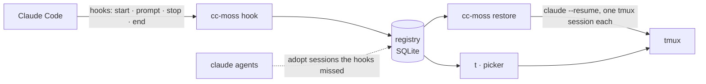

<p align="center">
  
</p>

<p align="center">
  <b>English</b> · <a href="README.zh-CN.md">简体中文</a>
</p>

<p align="center">
  <a href="https://github.com/larrykoo711/cc-moss/actions/workflows/ci.yml"></a>
  <a href="https://github.com/larrykoo711/cc-moss/releases/latest"></a>
  <a href="LICENSE"></a>
  
  
</p>

---

Your editor crashes, the laptop reboots, a terminal tab gets closed. Every Claude Code session that was open is gone,
and you are left digging through transcripts to remember which conversation was doing what.

**cc-moss** keeps a registry of every interactive Claude Code session, runs each one in its own tmux session, and
brings the interrupted ones back with a single command: same folder, same conversation, same model and permission
mode.

<p align="center">
  
</p>

## Highlights

- **Nothing to remember.** Claude Code hooks register sessions as they start, rename, work and end. Sessions that were
  already running before setup are adopted the next time you look.
- **Restore after a crash.** `cc-moss restore` reopens every interrupted session in its own tmux session with
  `claude --resume`, in its original folder and with the flags that shape it (see [what comes back](#what-comes-back)).
- **One name, one session.** `cc-moss new api-gateway` jumps into `api-gateway` if it is running, offers to restore it if
  it was interrupted, and only starts a new one otherwise. Renaming inside Claude Code (`/rename`) renames the tmux
  session too.
- **Notes that survive.** Write down what a session is for and where it stopped, and see it the next morning.
- **A picker for humans.** Type to search or to name a new session, arrow keys to move, Enter to open, → for more,
  Esc to go back. The mouse works too. No shortcuts to learn. Git worktrees are marked with the repository they
  belong to.
- **English and Chinese.** The interface follows your system language.
- **Local.** One SQLite file on your machine, no telemetry. See [Privacy](#privacy).

## Install

**Requirements:** macOS or Linux, [Claude Code](https://code.claude.com/docs), [tmux](https://github.com/tmux/tmux)
(3.2 or newer for the popup picker), and zsh for the `t` shortcut and shell additions (bash and fish users get
everything else; see the [FAQ](#faq)). The bundled starship prompt looks best with a [Nerd Font](https://www.nerdfonts.com).

```sh
brew install larrykoo711/tap/cc-moss     # macOS and Linux
cc-moss install                          # shows every change and asks first
cc-moss doctor                           # checks that everything is in place
```

<details>
<summary>Other ways to install</summary>

- **Prebuilt binaries** for macOS (Apple silicon, Intel) and Linux (x86_64, arm64, static) are on the
  [releases page](https://github.com/larrykoo711/cc-moss/releases). Unpack, put `cc-moss` on your `PATH`.
- **From source** (Rust 1.89 or newer, and a C compiler for the bundled SQLite):
  `cargo install --locked --git https://github.com/larrykoo711/cc-moss cc-moss`

</details>

`cc-moss install` sets up the whole terminal, adding to your files rather than overwriting them:

| Part | What it does |
|---|---|
| `hooks` | Four hooks in `~/.claude/settings.json`, so Claude Code reports session events; the `t` shortcut in `~/.zshrc` |
| `tmux` | A tuned config in `~/.config/cc-moss/tmux.conf`, loaded from one line at the top of your `~/.tmux.conf`; anything you set below that line wins |
| `starship` | A starship prompt, only if you have no starship config yet (`--replace-starship` to swap yours) |
| `shell` | Resets the terminal after a dropped ssh, and gives non-interactive shells (`ssh host cmd`, cron) the Homebrew PATH |
| `aliases` | Optional (`--with aliases`): `ll`, `lla`, `psg`, `gl`, plus `lg`/`lt` (eza), `catp`/`catn` (bat), `ff` (fd) and `psp` (procs) when those are installed. `ls`, `cat`, `grep` and `cd` keep their usual behaviour |

Leave a part out with `--skip <part>`. Shell additions live in clearly marked `# >>> cc-moss: … >>>` blocks, and each
changed file gets a timestamped backup with the same permissions. Missing tools are listed with the command that
installs them and run only if you agree: Homebrew on macOS; apt on Debian and Ubuntu, plus starship's official
installer (downloaded over HTTPS, then run) into `~/.local/bin`. Elsewhere cc-moss names the tools and leaves
installing them to you.

<details>
<summary>What the tmux config changes</summary>

The prefix stays `Ctrl-b`. On top of tmux's defaults it turns on the mouse, vi keys in copy mode, a 50k-line history,
windows numbered from 1, and a status bar. Keys it binds after the prefix: `t` opens the picker (instead of the clock),
`r` reloads the config, `|` and `-` split, `c` opens a window in the current folder, `h` `j` `k` `l` move between panes
(so `l` no longer jumps to the last window) and `H` `J` `K` `L` resize them. Put your own `bind` lines below the
cc-moss block in `~/.tmux.conf` to take any of them back.

</details>

Only want session tracking? `cc-moss setup` installs just the hooks and `t`.

### Uninstall

```sh
cc-moss install --uninstall      # removes the hooks, every cc-moss block and the files it created; asks first
brew uninstall cc-moss           # or delete the binary; do this second, so the hooks are gone first
rm -rf ~/.local/state/cc-moss    # optional: the registry and its log
```

## Usage

```sh
t                                    # open the picker (same as plain `cc-moss`)
t api                                # open it already searching for "api"
cc-moss new api-gateway              # start, jump into or restore the session named api-gateway
cc-moss new -C ~/code/acme -- --model opus   # pick the folder, pass arguments through to claude
cc-moss note api-gateway --state "Waiting for the staging config"
cc-moss ls                           # interrupted sessions first, then running ones
cc-moss restore                      # after a crash: bring everything back
```

In the picker:

| Mark | Meaning |
|:---:|---|
| ⣤ | Claude is working (dots run along a figure eight) |
| ● | Waiting for you |
| ↺ | Interrupted: press Enter to restore it |
| ○ | A plain tmux session, without Claude Code |

<table>
  <tr>
    <td width="50%"></td>
    <td width="50%"></td>
  </tr>
  <tr>
    <td align="center"><sub>Interrupted sessions keep their note and last message</sub></td>
    <td align="center"><sub>→ opens the menu: open, write a note, end the session</sub></td>
  </tr>
</table>

### Commands

| Command | What it does |
|---|---|
| `cc-moss` / `cc-moss pick [QUERY]` | Pick a session, an interrupted session or a folder |
| `cc-moss new [NAME] [-C DIR] [--detach] [--yes] [-- ARGS]` | Start a named session in its own tmux session; reuse it if the name exists |
| `cc-moss ls [--all] [--json]` | List sessions (`--json` for scripts; may still change before 1.0) |
| `cc-moss restore [NAMES] [--dry-run] [--yes]` | Bring interrupted sessions back |
| `cc-moss attach NAME` | Jump to a session's tmux session |
| `cc-moss note NAME [TEXT] [--goal G] [--state S] [--clear]` | Show or set a session's notes |
| `cc-moss close NAMES` | Stop offering sessions for restore |
| `cc-moss install [--with aliases] [--skip PART] [--replace-starship] [--uninstall] [--dry-run] [--yes]` | Set up (or remove) hooks, tmux, starship and shell blocks, and the tools they need |
| `cc-moss doctor` | Check every piece and say how to fix what is off |
| `cc-moss setup [--uninstall] [--dry-run] [--yes]` | Install or remove only the hooks and the `t` shortcut |

`NAME` can be the Claude Code session name, the tmux session name or the start of the session id.

## How it works



Each session gets a record in the registry with its Claude Code session id, folder, launch flags, process and tmux
session. A session that disappears without saying goodbye (a crash, a reboot, a killed terminal) is **interrupted**;
one you end on purpose is **closed** and never offered again. The hook is built to stay out of the way: it finishes in
a few milliseconds, never blocks a prompt, and does nothing at all if the cc-moss binary is gone.

### What comes back

`restore` resumes the same conversation (`claude --resume <id>`) in the same folder, and re-applies these flags if the
session was started with them: `--model`, `--permission-mode`, `--effort`, `--add-dir`, `--agent` and
`--dangerously-skip-permissions`. Other flags (`--mcp-config`, `--settings`, system prompts) are not carried over, and
any value that looks like a secret is dropped.

## How it compares

| | Brings back Claude conversations | Knows which session was where | After a reboot |
|---|:---:|:---:|:---:|
| `claude --resume` / `--continue` | one at a time, you pick | no | by hand, per session |
| tmux-resurrect / continuum | no (restores panes and shells) | panes only | yes |
| **cc-moss** | all interrupted ones, in one go | yes: name, folder, notes | one command |

They also combine: cc-moss runs inside tmux, so resurrect can keep your other panes while cc-moss looks after Claude.

## Privacy

cc-moss runs locally and sends nothing anywhere. It keeps:

- `~/.local/state/cc-moss/registry.db`: for each session, its id, name, folder, launch flags, process id, tmux session,
  your notes, and the first 200 characters of your latest prompt (shown in the picker).
- `~/.local/state/cc-moss/hook.log`: hook errors, capped at 1 MB.

The state folder is readable only by you. It reads Claude Code's own session files and runs `claude agents`, `ps` and
`tmux` on your machine. The only network access is the tool installation in `cc-moss install`, and only after you say
yes.

## Configuration

Optional, in `~/.config/cc-moss/config.toml`:

```toml
[claude]
default_args = ["--dangerously-skip-permissions"]   # added to every `cc-moss new`

[naming]
host_prefix = true        # default: name tmux sessions <host>_<name>, handy when you ssh between machines

[tmux]
socket = "work"           # a tmux -L name or a socket path; the default server if unset

[ui]
icons = "auto"            # Nerd Font icons: "auto" (when starship is loaded), "nerd" or "text"
language = "auto"         # "auto" (your system language), "en" or "zh"
```

<details>
<summary>Environment variables</summary>

| Variable | Effect |
|---|---|
| `CC_MOSS_LANG` | `en` or `zh`, overrides `[ui] language` and the system language |
| `CC_MOSS_CONFIG` | Path to the config file |
| `CC_MOSS_STATE_DIR` | Where the registry lives (default `$XDG_STATE_HOME/cc-moss` or `~/.local/state/cc-moss`) |
| `CC_MOSS_TMUX_SOCKET` | Same as `[tmux] socket` |
| `CLAUDE_CONFIG_DIR` | Where Claude Code's `settings.json` is (default `~/.claude`) |
| `ZDOTDIR`, `STARSHIP_CONFIG`, `XDG_CONFIG_HOME` | Respected when finding `.zshrc`, the starship config and `~/.config` |
| `NO_COLOR` | Plain output |

Chinese locales, including Traditional Chinese ones, use the Simplified Chinese interface.

</details>

## FAQ

**`t: command not found` after installing.** Open a new terminal (or `exec zsh`) so `~/.zshrc` is read again.

**I use bash or fish.** `cc-moss install` still sets up the hooks, tmux and the starship config, and leaves your shell
files alone: add starship's init line for your shell yourself if you want the prompt. Run `cc-moss pick` (or bind it
to a key) instead of `t`.

**Something isn't being tracked.** Run `cc-moss doctor`: it checks the hooks, tmux, the prompt and the tools, and says
how to fix each one.

**I use several machines.** Each machine has its own registry. With `host_prefix` (the default), tmux sessions are named
`<host>_<name>`, so you can tell them apart over ssh.

## Roadmap

- [x] Session registry, hooks, restore and notes
- [x] The `t` picker
- [x] `cc-moss install` / `doctor`: a curated tmux and starship setup
- [x] Prebuilt binaries and a Homebrew tap
- [ ] A native macOS menu bar app

Changes are listed in the [changelog](CHANGELOG.md). cc-moss is alpha (0.x): commands and `ls --json` may still change
before 1.0.

## Contributing

Bug reports, ideas and pull requests are welcome; start with [CONTRIBUTING.md](CONTRIBUTING.md). Security issues go
through [SECURITY.md](SECURITY.md). The design notes, plan and specs live in [`.sdd/`](.sdd/) (in Chinese, with an
English guide).

## Why "MOSS"?

MOSS is the AI in *The Wandering Earth* whose mission is to keep human civilization going. cc-moss has a smaller
mission: keep your Claude Code work going, whatever happens to the machine.

## License

[MIT](LICENSE). cc-moss is an independent project, not affiliated with Anthropic.
