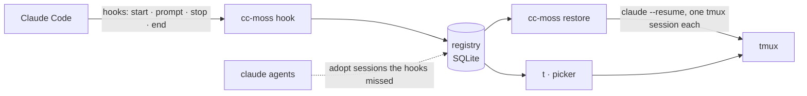

<p align="center">
  
</p>

<p align="center">
  <b>English</b> · <a href="README.zh-CN.md">简体中文</a>
</p>

<p align="center">
  <a href="LICENSE"></a>
  
  
  
</p>

---

Your editor crashes, the laptop reboots, a terminal tab gets closed. Every Claude Code session that was open is gone,
and you are left digging through transcripts to remember which conversation was doing what.

**cc-moss** keeps a registry of every interactive Claude Code session, runs each one in its own tmux session, and
brings the interrupted ones back with a single command, in the right folder, with the same arguments and the same
conversation.

<p align="center">
  
</p>

## Highlights

- **Nothing to remember.** Claude Code hooks register sessions as they start, rename, work and end. Sessions that were
  already running before setup are adopted the next time you look.
- **Restore after a crash.** `cc-moss restore` reopens every interrupted session in its own tmux session with
  `claude --resume`, the original working directory and launch arguments (anything that looks like a secret is dropped).
- **One name, one session.** `cc-moss new api-gateway` jumps into `api-gateway` if it is running, offers to restore it if
  it was interrupted, and only starts a new one otherwise. Renaming inside Claude Code (`/rename`) renames the tmux
  session too.
- **Notes that survive.** Write down what a session is for and where it stopped, and see it the next morning.
- **A picker for humans.** Type to search or to name a new session, arrow keys to move, Enter to open, → for more,
  Esc to go back. The mouse works too. No shortcuts to learn.
- **Local and private.** One SQLite file on your machine. cc-moss never talks to the network.

## Install

Requirements: macOS or Linux, [tmux](https://github.com/tmux/tmux), [Claude Code](https://docs.anthropic.com/en/docs/claude-code),
and a Rust toolchain (1.80 or newer) to build from source.

```sh
cargo install --git https://github.com/larrykoo711/cc-moss cc-moss
cc-moss setup
```

`cc-moss setup` shows a diff and asks before it changes anything:

- it adds four hooks to `~/.claude/settings.json`, so Claude Code reports session events to cc-moss;
- it adds a small, clearly marked block to `~/.zshrc` that defines the `t` shortcut.

A timestamped backup is kept next to each file. `cc-moss setup --uninstall` removes both again and leaves the rest of
your settings untouched.

## Usage

```sh
t                                    # open the picker (same as plain `cc-moss`)
cc-moss new api-gateway              # start, jump into or restore the session named api-gateway
cc-moss new -C ~/code/acme -- --model opus   # pick the folder, pass arguments through to claude
cc-moss note api-gateway --state "Waiting for the production key"
cc-moss ls                           # interrupted sessions first, then running ones
cc-moss restore                      # after a crash: bring everything back
```

In the picker:

| Mark | Meaning |
|:---:|---|
| ✶ | Claude is working (animated) |
| ● | Waiting for you |
| ↺ | Interrupted: press Enter to restore it |
| ○ | A plain tmux session, without Claude Code |

<table>
  <tr>
    <td width="50%"></td>
    <td width="50%"></td>
  </tr>
  <tr>
    <td align="center"><sub>Interrupted sessions keep their note and last message</sub></td>
    <td align="center"><sub>→ opens the menu: open, write a note, end the session</sub></td>
  </tr>
</table>

### Commands

| Command | What it does |
|---|---|
| `cc-moss` / `cc-moss pick` | Pick a session, an interrupted session or a folder |
| `cc-moss new [NAME] [-C DIR] [-- ARGS]` | Start a named session in its own tmux session; reuse it if the name exists |
| `cc-moss ls [--all] [--json]` | List sessions; `--json` is a stable, versioned schema |
| `cc-moss restore [NAMES] [--dry-run] [--yes]` | Bring interrupted sessions back |
| `cc-moss attach NAME` | Jump to a session's tmux session |
| `cc-moss note NAME [TEXT] [--goal G] [--state S] [--clear]` | Show or set a session's notes |
| `cc-moss close NAMES` | Stop offering sessions for restore |
| `cc-moss setup [--dry-run] [--uninstall]` | Install or remove the hooks and the `t` shortcut |

## How it works



Each session gets a slot in the registry that records its Claude Code session id, folder, launch arguments, process
and tmux session. A session that disappears without saying goodbye (a crash, a reboot, a killed terminal) is
**interrupted**; one you end on purpose is **closed** and never offered again. The registry lives at
`~/.local/state/cc-moss/registry.db`.

## Configuration

Optional, in `~/.config/cc-moss/config.toml`:

```toml
[claude]
default_args = ["--dangerously-skip-permissions"]   # added to every `cc-moss new`

[naming]
host_prefix = true        # name tmux sessions <host>_<name>, handy when you ssh between machines

[tmux]
socket = "work"           # a tmux -L name or a socket path; the default server if unset
```

## Roadmap

- [x] Session registry, hooks, restore and notes
- [x] The `t` picker
- [ ] `cc-moss install` / `doctor`: a curated tmux and starship setup
- [ ] Prebuilt binaries and a Homebrew tap
- [ ] A native macOS menu bar app

## Development

```sh
cargo test --all          # end-to-end tests run on a private tmux socket and a throwaway HOME
cargo clippy --all-targets -- -D warnings
```

The design notes, plan and specs live in [`.sdd/`](.sdd/) (in Chinese).

## Why "MOSS"?

MOSS is the AI in *The Wandering Earth* whose mission is to keep human civilization going. cc-moss has a smaller
mission: keep your Claude Code work going, whatever happens to the machine.

## License

[MIT](LICENSE)
