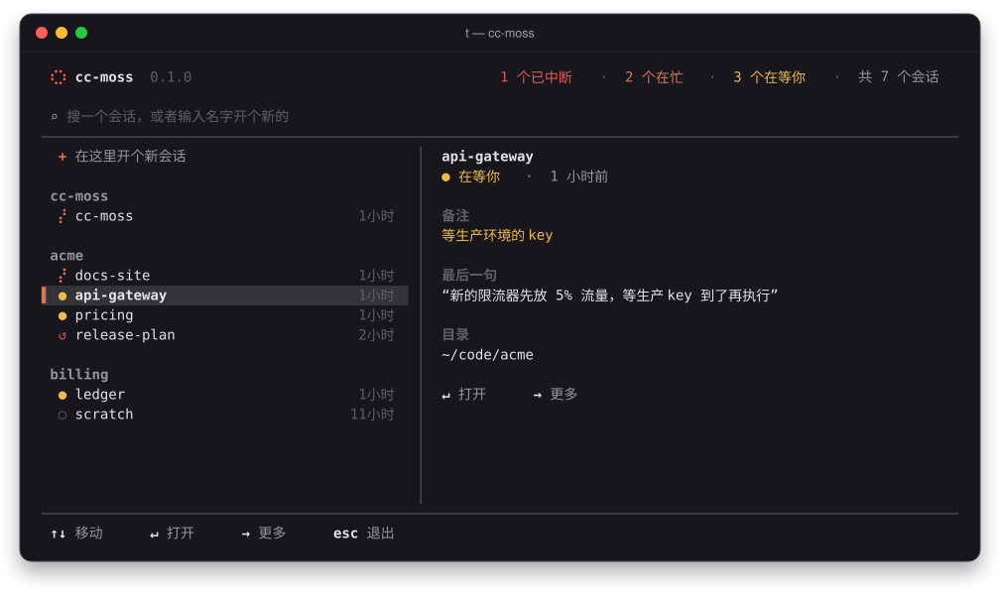
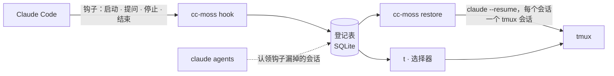

<p align="center">
  
</p>

<p align="center">
  <a href="README.md">English</a> · <b>简体中文</b>
</p>

<p align="center">
  <a href="https://github.com/larrykoo711/cc-moss/actions/workflows/ci.yml"></a>
  <a href="https://github.com/larrykoo711/cc-moss/releases/latest"></a>
  <a href="LICENSE"></a>
  
  
</p>

---

编辑器崩溃、电脑重启、终端标签页被误关，开着的 Claude Code 会话一下子全没了。
接下来只能一份份翻会话记录，回忆哪个会话在做什么、做到了哪一步。

**cc-moss** 为每个交互式 Claude Code 会话做登记，让每个会话独占一个 tmux 会话；中断之后一条命令就能全部找回：
目录对、对话接得上，模型和权限模式也和原来一样。

<p align="center">
  
</p>

## 亮点

- **不用记任何东西**：通过 Claude Code 钩子，会话的启动、改名、工作、结束都会自动登记。
  装好之前就在跑的会话，下次打开时也会被自动认领。
- **崩溃后一键恢复**：`cc-moss restore` 把每个中断的会话用 `claude --resume` 拉回各自的 tmux 会话，
  回到原来的目录，带上原来那几个关键参数（见[恢复时带回什么](#恢复时带回什么)）。
- **一个名字只对应一个会话**：`cc-moss new api-gateway` 时，同名会话在运行就直接进入，已中断就提示恢复，
  都没有才新建。在 Claude Code 里 `/rename` 改名，tmux 会话名也会跟着改。
- **备注不会丢**：写下会话在做什么、停在哪里，第二天打开还在。
- **人人都会用的选择器**：打字即搜索（或输入新会话的名字），方向键移动，回车打开，→ 更多操作，Esc 返回，
  也支持鼠标。没有要背的快捷键。git worktree 会标出它所属的主仓。
- **中英双语**：界面跟随系统语言。
- **数据留在本机**：只是本机上的一个 SQLite 文件，没有任何统计上报，详见[隐私](#隐私)。

## 安装

**需要：** macOS 或 Linux、[Claude Code](https://code.claude.com/docs)、[tmux](https://github.com/tmux/tmux)
（弹出式选择器需要 3.2 及以上），`t` 快捷命令和 shell 区块需要 zsh（bash、fish 用户其余功能照常可用，见[常见问题](#常见问题)）。
自带的 starship 提示符配合 [Nerd Font](https://www.nerdfonts.com) 显示效果最好。

```sh
brew install larrykoo711/tap/cc-moss     # macOS 与 x86_64 Linux
cc-moss install                          # 先把每处改动给你看，问过再改
cc-moss doctor                           # 检查是否都装好了
```

<details>
<summary>其他安装方式</summary>

- **预编译二进制**：macOS（Apple 芯片、Intel）与 Linux（x86_64、arm64，静态链接）见
  [Releases 页面](https://github.com/larrykoo711/cc-moss/releases)，解压后把 `cc-moss` 放进 `PATH` 即可。
  arm64 的 Linux 上 Homebrew 跑不起来，请用这种方式。
- **从源码构建**（Rust 1.89 及以上，另需 C 编译器来编译内置的 SQLite）：
  `cargo install --locked --git https://github.com/larrykoo711/cc-moss cc-moss`

</details>

`cc-moss install` 会把整套终端配置装好，只往你的文件里追加，不覆盖：

| 部分 | 做什么 |
|---|---|
| `hooks` | 在 `~/.claude/settings.json` 写入四个钩子，让 Claude Code 上报会话事件；在 `~/.zshrc` 加上 `t` 快捷命令 |
| `tmux` | 一份调好的配置 `~/.config/cc-moss/tmux.conf`，由 `~/.tmux.conf` 顶部的一行引入；写在那行之后的设置都以你的为准 |
| `starship` | starship 提示符，只在你还没有 starship 配置时写入（加 `--replace-starship` 替换你的） |
| `shell` | ssh 断线后自动复位终端；让非交互 shell（`ssh host cmd`、cron）也能用到 Homebrew 的 PATH |
| `aliases` | 可选（`--with aliases`）：`ll`、`lla`、`psg`、`gl`，装了对应工具时再加 `lg`/`lt`（eza）、`catp`/`catn`（bat）、`ff`（fd）、`psp`（procs）。`ls`、`cat`、`grep`、`cd` 保持原样 |

用 `--skip <部分>` 跳过某一项。shell 里的改动都放在醒目的 `# >>> cc-moss: … >>>` 区块中，每个被改动的文件都会留一份
带时间戳、权限不变的备份。缺少的工具会连同安装命令一起列出来，你同意才执行：macOS 用 Homebrew；Debian 与 Ubuntu 用 apt，
starship 则用官方安装脚本（先经 HTTPS 下载，再执行）装到 `~/.local/bin`。其他系统只列出工具名，由你自己安装。

<details>
<summary>tmux 配置改了什么</summary>

前缀键仍是 `Ctrl-b`。在 tmux 默认值之上打开了鼠标、复制模式的 vi 按键、5 万行历史、窗口从 1 开始编号，以及一条状态栏。
前缀键之后新绑定的按键：`t` 打开选择器（原来是时钟），`r` 重载配置，`|` 和 `-` 分屏，`c` 在当前目录开新窗口，
`h` `j` `k` `l` 在面板间移动（所以 `l` 不再跳回上一个窗口），`H` `J` `K` `L` 调整面板大小。
想换回哪个，就在 `~/.tmux.conf` 里 cc-moss 区块之后写上你自己的 `bind`。

</details>

只想要会话登记？`cc-moss setup` 只装钩子和 `t`。

### 升级

```sh
cc-moss update                   # 检查新版本，告诉你更新了什么，问过再升级
```

它会按你当初的安装方式升级：Homebrew 装的用 `brew upgrade`，源码装的用 `cargo install`；从 Releases 下载的，
则下载新的二进制，对照发布的 SHA-256 校验无误后替换。Homebrew 用户直接 `brew upgrade cc-moss` 也一样。
选择器和 `doctor` 每天最多检查一次新版本，有就提醒你；它发送了什么、怎么关掉，见[隐私](#隐私)。

### 卸载

```sh
cc-moss install --uninstall      # 移除钩子、所有 cc-moss 区块和它创建的文件；先给你看，问过再改
brew uninstall cc-moss           # 或删掉二进制；放在第二步，确保钩子已经先撤掉
rm -rf ~/.local/state/cc-moss    # 可选：登记表和它的日志
```

## 用法

```sh
t                                    # 打开选择器（等同于直接运行 `cc-moss`）
t api                                # 打开时已经在搜「api」
cc-moss new api-gateway              # 新建、进入或恢复名为 api-gateway 的会话
cc-moss new -C ~/code/acme -- --model opus   # 指定目录，并把参数透传给 claude
cc-moss note api-gateway --state "在等预发环境的配置"
cc-moss ls                           # 先列中断的会话，再列运行中的
cc-moss restore                      # 崩溃之后：全部找回来
```

选择器里的标记：

| 标记 | 含义 |
|:---:|---|
| ⣤ | Claude 正在干活（点沿着 8 字跑） |
| ● | 在等你 |
| ↺ | 中断了：按回车恢复 |
| ○ | 普通 tmux 会话，没有 Claude Code |

<table>
  <tr>
    <td width="50%"></td>
    <td width="50%"></td>
  </tr>
  <tr>
    <td align="center"><sub>中断的会话保留着备注和最后一句话</sub></td>
    <td align="center"><sub>按 → 打开菜单：进入、写备注、结束会话</sub></td>
  </tr>
</table>

### 命令

| 命令 | 做什么 |
|---|---|
| `cc-moss` / `cc-moss pick [关键词]` | 选择会话、中断的会话或目录 |
| `cc-moss new [名字] [-C 目录] [--detach] [--yes] [-- 参数]` | 新建一个命名会话，独占一个 tmux 会话；同名已存在则复用 |
| `cc-moss ls [--all] [--json]` | 列出会话（`--json` 给脚本用；1.0 之前格式仍可能调整） |
| `cc-moss restore [名字…] [--dry-run] [--yes]` | 把中断的会话恢复回来 |
| `cc-moss attach 名字` | 跳到会话所在的 tmux 会话 |
| `cc-moss note 名字 [文字] [--goal 目标] [--state 进度] [--clear]` | 查看或设置会话备注 |
| `cc-moss close 名字…` | 不再提示恢复这些会话 |
| `cc-moss install [--with aliases] [--skip 部分] [--replace-starship] [--uninstall] [--dry-run] [--yes]` | 安装（或移除）钩子、tmux、starship 与 shell 区块，以及它们需要的工具 |
| `cc-moss doctor` | 逐项体检，并告诉你怎么修 |
| `cc-moss update [--check] [--yes]` | 检查新版本并升级（`--check` 只看不装） |
| `cc-moss setup [--uninstall] [--dry-run] [--yes]` | 只安装或移除钩子和 `t` 快捷命令 |

`名字` 可以是 Claude Code 里的会话名、tmux 会话名，或会话 id 的开头几位。

## 工作原理



每个会话在登记表里有一条记录：Claude Code 会话 id、目录、启动参数、进程和 tmux 会话。
没有正常告别就消失的会话（崩溃、重启、终端被关）记为**中断**；你主动结束的记为**关闭**，之后不再提示恢复。
钩子尽量不打扰你：几毫秒就结束，从不阻塞提问；cc-moss 的二进制不在了，它就什么都不做。

### 恢复时带回什么

`restore` 在原来的目录里接上同一段对话（`claude --resume <id>`），如果会话启动时带了下面这些参数，也会原样带上：
`--model`、`--permission-mode`、`--effort`、`--add-dir`、`--agent`、`--dangerously-skip-permissions`。
其他参数（`--mcp-config`、`--settings`、系统提示词等）不会带回，看起来像密钥的值一律丢弃。

## 和其他方案比

| | 找回 Claude 对话 | 知道哪个会话在哪 | 重启之后 |
|---|:---:|:---:|:---:|
| `claude --resume` / `--continue` | 一次一个，自己挑 | 不知道 | 逐个手动 |
| tmux-resurrect / continuum | 不能（恢复的是面板和 shell） | 只有面板 | 可以 |
| **cc-moss** | 所有中断的会话，一次找回 | 知道：名字、目录、备注 | 一条命令 |

两者也能一起用：cc-moss 本身跑在 tmux 里，resurrect 照看其他面板，cc-moss 照看 Claude。

## 隐私

cc-moss 只在本机运行，不往任何地方发送关于你的数据。它保存：

- `~/.local/state/cc-moss/registry.db`：每个会话的 id、名字、目录、启动参数、进程 id、tmux 会话、你的备注，
  以及最近一次提问的前 200 个字符（在选择器里显示）。
- `~/.local/state/cc-moss/hook.log`：钩子的错误日志，最多 1 MB。
- `~/.local/state/cc-moss/update.json`：上次检查新版本的时间和结果。

状态目录只有你自己能读。它会读取 Claude Code 自己的会话文件，并在本机运行 `claude agents`、`ps` 和 `tmux`。
只有两处会联网：

- **检查新版本**：打开选择器或运行 `doctor` 时，每天最多一次，用 `curl` 向
  `https://github.com/larrykoo711/cc-moss/releases/latest` 问一下它指向哪个版本。就是一个普通的 HTTPS 请求，
  不带任何关于你、你的会话或你这台机器的信息；在后台进行，3 秒没回应就放弃。钩子和 `ls --json` 从不联网。
  在配置文件里写 `[update] check = false` 或设置 `CC_MOSS_NO_UPDATE_CHECK=1` 即可关闭；关闭后你自己运行
  `cc-moss update` 照样能用。
- **安装你同意的东西**：`cc-moss install` 里的工具，以及 `cc-moss update` 下载的新版本。

## 配置

可选，位于 `~/.config/cc-moss/config.toml`：

```toml
[claude]
default_args = ["--dangerously-skip-permissions"]   # 每次 `cc-moss new` 都会带上

[naming]
host_prefix = true        # 默认开启：tmux 会话名为 <主机名>_<名字>，在多台机器间 ssh 时更好区分

[tmux]
socket = "work"           # tmux -L 的名字或 socket 路径；不设置则用默认 server

[ui]
icons = "auto"            # Nerd Font 图标："auto"（检测到 starship 时启用）、"nerd" 或 "text"
language = "auto"         # "auto"（跟随系统语言）、"en" 或 "zh"

[update]
check = true              # 每天检查一次新版本（选择器和 doctor）；false 关闭
```

<details>
<summary>环境变量</summary>

| 变量 | 作用 |
|---|---|
| `CC_MOSS_LANG` | `en` 或 `zh`，优先于 `[ui] language` 和系统语言 |
| `CC_MOSS_CONFIG` | 配置文件路径 |
| `CC_MOSS_STATE_DIR` | 登记表所在目录（默认 `$XDG_STATE_HOME/cc-moss` 或 `~/.local/state/cc-moss`） |
| `CC_MOSS_TMUX_SOCKET` | 同 `[tmux] socket` |
| `CC_MOSS_NO_UPDATE_CHECK` | 设为 `1` 关闭每天的新版本检查，同 `[update] check = false` |
| `CLAUDE_CONFIG_DIR` | Claude Code 的 `settings.json` 所在目录（默认 `~/.claude`） |
| `ZDOTDIR`、`STARSHIP_CONFIG`、`XDG_CONFIG_HOME` | 查找 `.zshrc`、starship 配置和 `~/.config` 时会遵循 |
| `NO_COLOR` | 输出不带颜色 |

所有中文地区（包括繁体中文地区）都使用简体中文界面。

</details>

## 常见问题

**装完后提示 `t: command not found`。** 新开一个终端（或执行 `exec zsh`），让 `~/.zshrc` 重新加载。

**我用 bash 或 fish。** `cc-moss install` 照样会装好钩子、tmux 和 starship 配置，不会动你的 shell 配置文件；
想要这个提示符的话，自己在 shell 配置里加上 starship 的 init 那一行。用 `cc-moss pick`（或给它绑个键）代替 `t`。

**有会话没被登记上。** 运行 `cc-moss doctor`：它会检查钩子、tmux、提示符和各个工具，并告诉你每一项怎么修。

**我有好几台机器。** 每台机器各有自己的登记表。`host_prefix` 默认开启，tmux 会话名带着 `<主机名>_` 前缀，ssh 过去也分得清。

## 路线图

- [x] 会话登记、钩子、恢复与备注
- [x] `t` 选择器
- [x] `cc-moss install` / `doctor`：一套精选的 tmux 与 starship 配置
- [x] 预编译二进制与 Homebrew tap
- [ ] macOS 原生菜单栏 App

变更记录见 [CHANGELOG](CHANGELOG.md)。cc-moss 目前是 alpha（0.x），1.0 之前命令和 `ls --json` 的格式仍可能调整。

## 参与

欢迎报 bug、提想法、发 PR，先看 [CONTRIBUTING.zh-CN.md](CONTRIBUTING.zh-CN.md)；安全问题请走 [SECURITY.md](SECURITY.md)。
设计说明、计划与 spec 位于 [`.sdd/`](.sdd/)。

## 为什么叫 MOSS？

MOSS 是《流浪地球》里的人工智能，使命是让人类文明延续下去。cc-moss 的使命小一些：
无论机器发生什么，让你的 Claude Code 工作延续下去。

## 许可证

[MIT](LICENSE)。cc-moss 是独立项目，与 Anthropic 没有关联。
