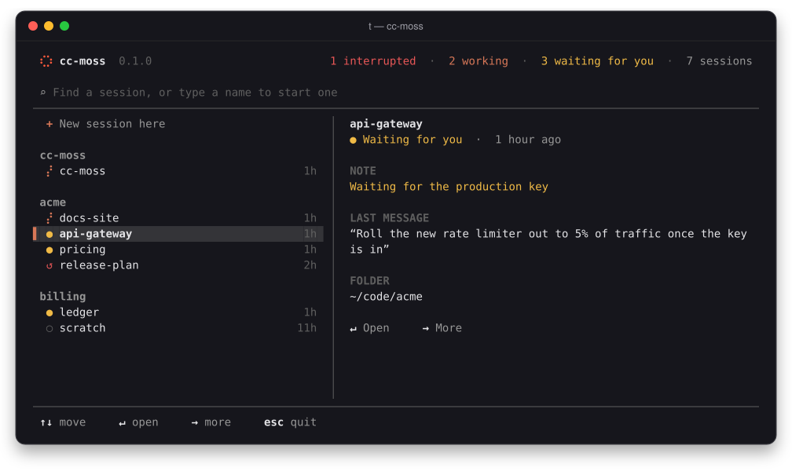
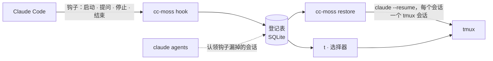

<p align="center">
  
</p>

<p align="center">
  <a href="README.md">English</a> · <b>简体中文</b>
</p>

<p align="center">
  <a href="LICENSE"></a>
  
  
  
</p>

---

编辑器崩溃、电脑重启、终端标签页被误关，开着的 Claude Code 会话一下子全没了。
接下来只能一份份翻会话记录，回忆哪个会话在做什么、做到了哪一步。

**cc-moss** 为每个交互式 Claude Code 会话做登记，让每个会话独占一个 tmux 会话；中断之后一条命令就能全部找回：
目录对、启动参数对、对话也接得上。

<p align="center">
  
</p>

## 亮点

- **不用记任何东西**：通过 Claude Code 钩子，会话的启动、改名、工作、结束都会自动登记。
  装好之前就在跑的会话，下次打开时也会被自动认领。
- **崩溃后一键恢复**：`cc-moss restore` 把每个中断的会话用 `claude --resume` 拉回各自的 tmux 会话，
  工作目录和启动参数保持原样（看起来像密钥的参数会被丢弃）。
- **一个名字只对应一个会话**：`cc-moss new api-gateway` 时，同名会话在运行就直接进入，已中断就提示恢复，
  都没有才新建。在 Claude Code 里 `/rename` 改名，tmux 会话名也会跟着改。
- **备注不会丢**：写下会话在做什么、停在哪里，第二天打开还在。
- **人人都会用的选择器**：打字即搜索（或输入新会话的名字），方向键移动，回车打开，→ 更多操作，Esc 返回，
  也支持鼠标。没有要背的快捷键。
- **本地、私密**：数据只是本机上的一个 SQLite 文件，cc-moss 不会联网。

## 安装

需要：macOS 或 Linux、[tmux](https://github.com/tmux/tmux)、[Claude Code](https://docs.anthropic.com/en/docs/claude-code)，
从源码构建还需要 Rust 工具链（1.80 及以上）。

```sh
cargo install --git https://github.com/larrykoo711/cc-moss cc-moss
cc-moss setup
```

`cc-moss setup` 会先展示改动的 diff，确认后才写入：

- 在 `~/.claude/settings.json` 中加入 4 个钩子，让 Claude Code 把会话事件告诉 cc-moss；
- 在 `~/.zshrc` 中加入一段带明确标记的小区块，定义 `t` 快捷命令。

每个文件旁都会留一份带时间戳的备份。`cc-moss setup --uninstall` 会把两处都移除，其余设置原样保留。

## 用法

```sh
t                                    # 打开选择器（等同于直接运行 `cc-moss`）
cc-moss new api-gateway              # 新建、进入或恢复名为 api-gateway 的会话
cc-moss new -C ~/code/acme -- --model opus   # 指定目录，并把参数透传给 claude
cc-moss note api-gateway --state "等生产环境的 key"
cc-moss ls                           # 先列中断的会话，再列运行中的
cc-moss restore                      # 崩溃之后：全部找回来
```

选择器里的标记：

| 标记 | 含义 |
|:---:|---|
| ✶ | Claude 正在工作（带动画） |
| ● | 在等你回复 |
| ↺ | 已中断：回车即可恢复 |
| ○ | 普通 tmux 会话，没有 Claude Code |

<table>
  <tr>
    <td width="50%"></td>
    <td width="50%"></td>
  </tr>
  <tr>
    <td align="center"><sub>中断的会话保留备注和最后一条消息</sub></td>
    <td align="center"><sub>→ 打开菜单：打开、写备注、结束会话</sub></td>
  </tr>
</table>

### 命令一览

| 命令 | 作用 |
|---|---|
| `cc-moss` / `cc-moss pick` | 选择会话、中断的会话或目录 |
| `cc-moss new [NAME] [-C DIR] [-- ARGS]` | 在独立的 tmux 会话中启动命名会话；名字已存在则复用 |
| `cc-moss ls [--all] [--json]` | 列出会话；`--json` 输出稳定、带版本号的结构 |
| `cc-moss restore [NAMES] [--dry-run] [--yes]` | 恢复中断的会话 |
| `cc-moss attach NAME` | 跳到会话所在的 tmux 会话 |
| `cc-moss note NAME [TEXT] [--goal G] [--state S] [--clear]` | 查看或设置会话备注 |
| `cc-moss close NAMES` | 不再提示恢复这些会话 |
| `cc-moss setup [--dry-run] [--uninstall]` | 安装或移除钩子与 `t` 快捷命令 |

## 工作原理



每个会话在登记表里占一个槽位，记录 Claude Code 会话 id、目录、启动参数、进程和 tmux 会话。
没有正常告别就消失的会话（崩溃、重启、终端被关）记为**中断**；你主动结束的记为**关闭**，之后不再提示恢复。
登记表位于 `~/.local/state/cc-moss/registry.db`。

## 配置

可选，位于 `~/.config/cc-moss/config.toml`：

```toml
[claude]
default_args = ["--dangerously-skip-permissions"]   # 每次 `cc-moss new` 都会带上

[naming]
host_prefix = true        # tmux 会话名为 <主机名>_<名字>，在多台机器间 ssh 时更好区分

[tmux]
socket = "work"           # tmux -L 的名字或 socket 路径；不设置则用默认 server
```

## 路线图

- [x] 会话登记、钩子、恢复与备注
- [x] `t` 选择器
- [ ] `cc-moss install` / `doctor`：一套精选的 tmux 与 starship 配置
- [ ] 预编译二进制与 Homebrew tap
- [ ] macOS 原生菜单栏 App

## 开发

```sh
cargo test --all          # 端到端测试跑在独立的 tmux socket 和临时 HOME 上
cargo clippy --all-targets -- -D warnings
```

设计说明、计划与 spec 位于 [`.sdd/`](.sdd/)。

## 为什么叫 MOSS？

MOSS 是《流浪地球》里的人工智能，使命是让人类文明延续下去。cc-moss 的使命小一些：
无论机器发生什么，让你的 Claude Code 工作延续下去。

## 许可证

[MIT](LICENSE)
