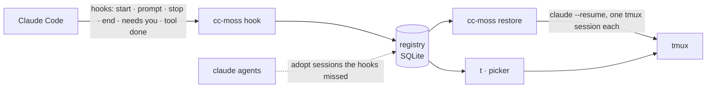

# cc-moss guide

**English** · [简体中文](guide.md) · [Back to the README](../README.en.md)

## Install

**Requirements:** macOS or Linux, [Claude Code](https://code.claude.com/docs), [tmux](https://github.com/tmux/tmux)
(3.2 or newer for the popup picker), and zsh for the shell additions (bash and fish users get everything else,
`t` included; see the [FAQ](#faq)). The bundled starship prompt looks best with a [Nerd Font](https://www.nerdfonts.com).

```sh
brew install larrykoo711/tap/cc-moss     # macOS and x86_64 Linux
cc-moss install                          # shows every change and asks first
cc-moss doctor                           # checks that everything is in place
```

<details>
<summary>Other ways to install</summary>

- **Prebuilt binaries** for macOS (Apple silicon, Intel) and Linux (x86_64, arm64, static) are on the
  [releases page](https://github.com/larrykoo711/cc-moss/releases). Unpack, put `cc-moss` on your `PATH`. This is
  the way for arm64 Linux, where Homebrew does not run. The macOS download has the menubar app (`cc-moss.app`) next
  to the binary: run `./cc-moss install` in the unpacked folder to put it in `~/Applications` as well, or drag
  `cc-moss.app` into Applications yourself.
- **From source** (Rust 1.89 or newer, and a C compiler for the bundled SQLite):
  `cargo install --locked --git https://github.com/larrykoo711/cc-moss cc-moss`

</details>

`cc-moss install` sets up the whole terminal, adding to your files rather than overwriting them:

| Part | What it does |
|---|---|
| `hooks` | Six hooks in `~/.claude/settings.json`, so Claude Code reports session events; the `t` alias (`~/.local/bin/t`, see [Aliases](#aliases)) |
| `tmux` | A tuned config in `~/.config/cc-moss/tmux.conf`, loaded from one line at the top of your `~/.tmux.conf`; anything you set below that line wins |
| `starship` | A starship prompt, only if you have no starship config yet (`--replace-starship` to swap yours) |
| `shell` | Resets the terminal after a dropped ssh, and gives non-interactive shells (`ssh host cmd`, cron) the Homebrew PATH |
| `app` | macOS only: the menubar app comes with cc-moss (in the Homebrew install and the macOS release download); after asking, it is copied to `~/Applications/cc-moss.app` and started. It has to live in an Applications folder for macOS to deliver its notifications; a copy of the same or a newer version, or a development build, is left alone, and so is everything under sudo (see [The menubar app](#the-menubar-app)) |
| `aliases` | Optional (`--with aliases`): `ll`, `lla`, `psg`, `gl`, plus `lg`/`lt` (eza), `catp`/`catn` (bat), `ff` (fd) and `psp` (procs) when those are installed. `ls`, `cat`, `grep` and `cd` keep their usual behaviour |

Leave a part out with `--skip <part>`. Shell additions live in clearly marked `# >>> cc-moss: … >>>` blocks, and each
changed file gets a timestamped backup with the same permissions. Missing tools are listed with the command that
installs them and run only if you agree: Homebrew on macOS; apt on Debian and Ubuntu, plus starship's official
installer (downloaded over HTTPS, then run) into `~/.local/bin`. Elsewhere cc-moss names the tools and leaves
installing them to you.

<details>
<summary>What the tmux config changes</summary>

The prefix stays `Ctrl-b`. On top of tmux's defaults it turns on the mouse, vi keys in copy mode, a 50k-line history,
windows numbered from 1, and a status bar. Keys it binds after the prefix: `t` opens the picker (instead of the clock),
`r` reloads the config, `|` and `-` split, `c` opens a window in the current folder, `h` `j` `k` `l` move between panes
(so `l` no longer jumps to the last window) and `H` `J` `K` `L` resize them. Put your own `bind` lines below the
cc-moss block in `~/.tmux.conf` to take any of them back.

</details>

Only want session tracking? `cc-moss setup` installs just the hooks and `t`.

### Updating

```sh
cc-moss update                   # checks for a new version, shows what is new, and asks before updating
```

It updates the way you installed: `brew upgrade` for Homebrew, `cargo install` for a source build, and for a release
download it fetches the new binary, checks it against the published SHA-256 and swaps it in. On macOS the menubar app in
`~/Applications` moves to the same version; if it was running, it quits first and opens again afterwards (a source
build has no app, so cc-moss tells you it stays on the old one). The app is never moved to an older version, a
development build is left alone, and under sudo the app is not touched at all. Homebrew users can also run `brew upgrade cc-moss` for
the CLI, then `cc-moss install` to bring the app along. Once a day the picker and `doctor` also look for a new version and mention it; see
[Privacy](#privacy) for what that sends and how to turn it off.

### Uninstall

```sh
cc-moss install --uninstall      # removes the hooks, every cc-moss block and the files it created; asks first
brew uninstall cc-moss           # or delete the binary; do this second, so the hooks are gone first
rm -rf ~/.local/state/cc-moss    # optional: the registry and its log
```

On macOS, `cc-moss install --uninstall` also quits and deletes `~/Applications/cc-moss.app` (only cc-moss's own app)
and the `~/Library/LaunchAgents/io.github.larrykoo711.cc-moss.login.plist` it writes for "Open at Login". It asks
about this separately; answer no to keep the app.

## Usage

```sh
t                                    # open the picker (same as plain `cc-moss`)
t api                                # open it already searching for "api"
cc-moss new api-gateway              # start, jump into or restore the session named api-gateway
cc-moss new -C ~/code/acme --model opus   # pick the folder; Claude Code's own flags go straight through
cc-moss note api-gateway --state "Waiting for the staging config"
cc-moss ls                           # interrupted sessions first, then running ones
cc-moss restore                      # after a crash: bring everything back
```

In the picker:

| Mark | Meaning |
|:---:|---|
| ⣤ | Claude is working (dots run along a figure eight) |
| ● | Waiting for you |
| ↺ | Interrupted: press Enter to restore it |
| ○ | A plain tmux session, without Claude Code |

<table>
  <tr>
    <td width="50%"></td>
    <td width="50%"></td>
  </tr>
  <tr>
    <td align="center"><sub>Interrupted sessions keep their note and last message</sub></td>
    <td align="center"><sub>→ opens the menu: open, write a note, end the session</sub></td>
  </tr>
</table>

### Commands

| Command | What it does |
|---|---|
| `cc-moss` / `cc-moss pick [QUERY]` | Pick a session, an interrupted session or a folder |
| `cc-moss new [NAME] [-C DIR] [--detach] [--yes] [-- ARGS]` | Start a named session in its own tmux session; reuse it if the name exists |
| `cc-moss ls [--all] [--json]` | List sessions (`--json` for scripts; may still change before 1.0) |
| `cc-moss events [--json] [--since SEQ] [--limit N]` | What just happened to your sessions, in order (for apps and scripts) |
| `cc-moss restore [NAMES] [--dry-run] [--yes [--json]]` | Bring interrupted sessions back (`--json` reports each one, failures with a stable reason code: `empty`, `missing_dir`, `exited_at_once`, `tmux_failed`, `already_running`) |
| `cc-moss attach NAME` | Jump to a session's tmux session |
| `cc-moss note NAME [TEXT] [--goal G] [--state S] [--clear]` | Show or set a session's notes (an empty value clears just that one; put text starting with `-` after `--`) |
| `cc-moss send NAME -- TEXT` | Type a message into a running session, as if you typed it in its terminal; several lines arrive whole |
| `cc-moss close NAMES` | Stop offering sessions for restore |
| `cc-moss install [--with aliases] [--skip PART] [--replace-starship] [--uninstall] [--dry-run [--json]] [--yes]` | Set up (or remove) hooks, tmux, starship and shell blocks, and the tools they need (`--dry-run --json` lists each part as `ready`, `changes`, `skipped` or `unsupported`, changing nothing) |
| `cc-moss alias ls [--json]` / `alias add NAME COMMAND…` / `alias rm NAME` | Manage aliases (see [Aliases](#aliases)) |
| `cc-moss config get KEY [--json]` / `config set KEY VALUE [--json]` | Read or change a setting; today only `ui.language` (`auto`, `zh`, `en`). `set` changes just that line and keeps comments and everything else (see [Configuration](#configuration)) |
| `cc-moss doctor [--fix]` | Check every piece and say how to fix what is off (`--fix` relinks broken aliases) |
| `cc-moss update [--check] [--yes]` | Look for a new version and install it (`--check` only looks) |
| `cc-moss setup [--uninstall] [--dry-run] [--yes]` | Install or remove only the hooks and the `t` alias |

`NAME` can be the Claude Code session name, the tmux session name or the start of the session id.

### Aliases

An alias is your own name for a cc-moss command. It works in every shell (zsh, bash, fish), in scripts and in new
terminals, right after you add it: no `source`. `t` is one: `t` is `cc-moss pick`.

```sh
cc-moss alias add tn new            # tn login-page  →  cc-moss new login-page
cc-moss alias add mycc "new --dangerously-skip-permissions"   # mycc login-page
cc-moss alias add tback "restore --yes"
cc-moss alias ls
cc-moss alias rm tn
```

How it works: an alias is a symlink in `~/.local/bin` to `cc-moss` (to the stable entry on your PATH, such as
`/opt/homebrew/bin/cc-moss`, so Homebrew upgrades do not break it). When cc-moss is started under another name, it looks
that name up in the `[aliases]` table of `config.toml` and runs that command with your arguments after it. The command
is split on whitespace, with single and double quotes grouping words, and **never goes through a shell**: `$(…)`, `;`
and `|` are plain text. It can only run cc-moss's own commands.

- Names use `a-z`, `0-9`, `-` and `_`. A name that is already a command on your PATH (like `ls`) is refused unless you
  add `--force`; a file in `~/.local/bin` that cc-moss did not create is never replaced.
- A shell alias or function with the same name runs instead of the alias. `alias add` and `doctor` point it out; your
  shell files are never edited.
- The menubar app's Settings › Shortcuts page (under "In the Terminal") adds, edits and removes them, through these same commands; the panel's shortcut lives on the same page.

## The menubar app

On a Mac, cc-moss also comes with an app that lives in the menu bar. It has the same version as the command line and
ships in the same release, and it does all its reading and writing through the `cc-moss` command; it never touches the
registry itself. It needs macOS 14 or newer. Linux has the terminal edition only, with every command above.

<table>
  <tr>
    <td width="42%"></td>
    <td width="58%"></td>
  </tr>
  <tr>
    <td align="center"><sub>The panel: sessions by project, stopped ones back in one click</sub></td>
    <td align="center"><sub>Mo knocks when a session needs you</sub></td>
  </tr>
</table>

### Install, update, uninstall

| You want to… | Do this |
|---|---|
| Install the app | `cc-moss install`: after asking, it copies `cc-moss.app` to `~/Applications` and opens it (`--skip app` leaves it out) |
| Update | `cc-moss update`: the command line and the app move to the new version together; a running app quits first and opens again afterwards |
| Uninstall | `cc-moss install --uninstall`: quits and deletes the app and its Open at Login item, after asking separately |

The Homebrew install and the macOS release downloads both carry the app; a source install (`cargo install`) does not.
`cc-moss doctor` tells you which version the app is and where it lives.

The first time it opens, a short welcome walks you through: setting up the terminal side (hooks, tmux, the prompt: the
same set as `cc-moss install`, in one click), Open at Login and notifications, the terminal you use, whether Mo should
come out, and finally the shortcut that opens the panel. Every step can be skipped, and Settings › About shows the
welcome again.

<p align="center">
  
</p>

### The menu bar icon

The icon is cc-moss's infinity loop, and it follows your sessions: one working, one waiting for you, one that stopped,
you can tell at a glance. "Needs you" wins over "stopped", which wins over "working". In Settings › Menu Bar:

- **Show**: the icon alone, or the icon and a number (how many need you; if none, how many stopped; if none, how many
  are working).
- **Motion**: on, the icon moves while a session works or needs you, for about 1–2% CPU. Off, it stays still and only
  changes when the state does, for free.

### The panel

Click the menu bar icon, or tap Control twice anywhere, and the panel opens. Sessions are grouped by project, with git
worktrees marked; the row at the top filters by state (all, working, waiting for you, stopped). Typing searches.

On a stopped session, Return brings it back: the same conversation, in tmux, exactly like `cc-moss restore`. When
several stopped at once (after a restart, say), a "2 sessions stopped" strip at the top has a Bring All Back button.
Sessions that stopped more than a week ago are folded under "Stopped earlier", and Stop Reminding sends any of them away
for good.

On a session you can open, Return opens a new window in your terminal, straight into the session. Terminal (the default),
Ghostty (recommended), iTerm2, WezTerm, Kitty and Alacritty are supported; pick yours in Settings › General. Using
another one? ⇧⌘C copies the command for you to paste.

Each session carries its own actions. Point at one and its buttons appear at the end of the row: Rename, Send a Message
and Open (Bring Back for a stopped session), then ⋯ for the rest: write a note, copy the command or the folder path,
stop reminding. Right-click a session, or press ⌘K, for all of them at once. What isn't about one session (new
session, refresh, settings, quit) is on the cc-moss logo at the bottom left.

| Key | What it does |
|---|---|
| Typing | Search sessions |
| ↑ ↓ | Move the selection |
| ↵ | Open the selected session; bring it back if it stopped |
| Tab / ⇧Tab | Cycle the filter: all, working, waiting, stopped |
| ⌘K | Every action for the selected session, next to it; ↑ ↓ and ↵ pick one |
| ⌘N | New session: a name and a folder |
| ⌘E | Send a message: types it into the session's terminal for you (a session outside tmux gets a note instead) |
| ⇧⌘C | Copy the command (for a stopped session, the restore command) |
| ⌘R | Refresh |
| ⌘, | Settings |
| Esc | Step back: close the form, the menu, the filter, the search, then the panel |
| ⌘Q | Quit the app |

Notes, renames and messages are typed right in the panel and go through `cc-moss note` and `cc-moss send`; a rename
simply types `/rename <new name>` into the session for you.

### Notifications and Mo

The app tells you when a session needs you (a permission prompt or a question), when one stops, and when a stopped one
is back. "Turn finished" is off by default: every turn ends with one, so it gets chatty. Settings › Notifications picks
which of these you hear about, and **who tells you**:

| Choice | What happens |
|---|---|
| Automatic (default) | Mo, while it's on your desktop; otherwise Notification Center |
| Notification Center | Always Notification Center; Mo only shows it on its face |
| Mo | Only Mo, even when it's tucked away at the edge |

Each alert comes from one place only: never a banner and Mo saying the same thing. The same alert from the same session
within 30 seconds counts once, and while the panel is open nothing pops up, since it's all in front of you already.

**After a restart**: sessions that stopped while your Mac restarted, or while the app wasn't running, are reported as
soon as the app starts ("3 sessions stopped"), and the panel brings them all back in one click.

**Mo** is a small graphite pebble that lives in a corner of your desktop: the infinity loop is its eyes, and the light
on its antenna shows what's going on. It stays in until you switch it on in Settings › Mo (the welcome asks too).

- Click it to open the panel. Drag it anywhere; near a screen edge it snaps to it.
- Right-click to keep it quiet for an hour, leave you be for today, hide by the edge with only its eyes showing, or
  clock off (hide).
- It comes in small, medium and large.
- **Interaction** sets how forward it is when something needs you: **Quiet** only makes a face, and you click it to
  see what's up; **Everyday** (the default) makes a face and murmurs a word or two, and hovering shows the rest;
  **Active** pops up the message right away, buttons and all.

<p align="center">
  
</p>

### Voice

Mo can make a sound too, under Settings › Mo › Voice:

- **Off** (the default): silent, faces only.
- **Chime**: a soft sound built into macOS, at most every 30 seconds.
- **Speak**: Mo reads the message title aloud, at most every 30 seconds. The voice is macOS's own speech synthesis,
  on your Mac, with nothing sent anywhere. Download a Premium or Enhanced voice in System Settings and it sounds far
  more natural.

### Settings

| Page | What's there |
|---|---|
| General | Open at Login, interface language, workspace, the terminal sessions open in, new tab or new window |
| Shortcuts | The shortcut for the panel; short names to type in a terminal (open the session list, start a session, bring stopped ones back…): click the keycap, type, Return saves, and it plays what the name does. Your own commands sit under the folded Your own; the same names as `cc-moss alias` (see [Aliases](#aliases)). The keys inside the panel |
| Menu Bar | How the icon shows, motion |
| Mo | On or off, size, interaction, voice |
| Notifications | Who tells you, what to tell you; a word when notifications are turned off |
| Permissions | Everything cc-moss asks macOS for, on one page: Accessibility, notifications, control of your terminal (Automation). Each says where it stands and what it's for, with Allow when one is missing. When one is off and something uses it, a small dot shows beside the page |
| About | App and command line versions, software update, where the `cc-moss` program is, the welcome again |

The search field at the top of the sidebar finds any setting.

**Shortcut**: tap Control twice, in any app. It needs cc-moss allowed once under System Settings › Privacy & Security › Accessibility; until then ⌃⌥M works. In Settings › Shortcuts you can switch to a key combination: click it and press a new one (it needs ⌃, ⌥ or ⌘, and you'll be told if another app has it).

**Workspace**: Claude works inside a folder. Pick one in Settings › General › Workspace and new sessions start there; otherwise they start in the folder you used last.

**Language**: the app and the command line share one interface language setting, so changing it on one side changes
both. Pick it in Settings › General, or run `cc-moss config set ui.language zh` (`en`, `zh`, or `auto` to follow the
system).

### Menubar app FAQ

**No notifications arrive**

macOS only sends notifications to an app in an Applications folder (`/Applications` or `~/Applications`).
`cc-moss install` puts it in `~/Applications`; if you moved it somewhere else, move it back. Still nothing? Check
notifications in Settings › Permissions: if they're turned off, click Open Settings and switch on Notifications ›
cc-moss.

**Double-tapping Control does nothing after an update**

cc-moss isn't signed with an Apple developer ID yet, so macOS sees each version as a new app: after an update
Accessibility stops working while System Settings still shows it ticked. The panel says "Allow Accessibility again" at
the top; click Allow and tick it once more (cc-moss clears the old entry first). Settings › Permissions does the same.

**Settings › About says "Versions differ"**

The app and the command line aren't the same version. The usual cause is running only `brew upgrade cc-moss`: Homebrew
updates the command line, and the app in `~/Applications` stays on the old version. Run `cc-moss install` once more to
bring the app along; from then on, `cc-moss update` moves both together.

**I chose Open, and the terminal did nothing**

The first time cc-moss opens a session in a terminal, macOS asks whether it may control that terminal. If you said no,
click Open Settings beside it in Settings › Permissions and switch it on under Privacy & Security › Automation, or press ⇧⌘C and paste the command yourself.

**The app can't find `cc-moss`**

It looks in the usual places (Homebrew, `~/.cargo/bin`, `~/.local/bin` and so on). If yours is somewhere else, choose it
in Settings › About › Command Line.

## How it works



Each session gets a record in the registry with its Claude Code session id, folder, launch flags, process and tmux
session. A session that disappears without saying goodbye (a crash, a reboot, a killed terminal) is **interrupted**;
one you end on purpose is **closed** and never offered again. The hook is built to stay out of the way: it finishes in
a few milliseconds, never blocks a prompt, and does nothing at all if the cc-moss binary is gone.

### Session events

Besides what things look like now, the registry keeps what just happened: a session started, began working, finished
its turn, needs you, was interrupted, ended, came back, was renamed or closed. Each is one numbered event, kept for 7
days. `cc-moss events --json` reads them, and `--since <seq>` returns only the newer ones, which suits a menu bar app or
your own script polling it:

```sh
cc-moss events --json --since 42
# {"schema":1,"events":[{"seq":43,"slot_id":"…","name":"api","kind":"needs_you",
#   "detail":{"reason":"permission","message":"Claude needs your permission"},"at":"2026-10-16T08:00:00Z"}],"last_seq":43}
```

Pass `last_seq` back as `--since` next time. `kind` is one of `started`, `working`, `finished`, `needs_you`, `renamed`,
`ended`, `interrupted`, `restored` and `closed`; events never hold your prompts.

**Needs you**: when Claude Code shows a permission prompt, asks a question or waits for input, it sends a notification
about 6 seconds later. cc-moss records `needs_you`, and the session's `attention` in `ls --json` becomes `permission`,
`question` or `input`. It clears by itself once you approve (the tool finishes), reply, the turn ends or the session
exits. cc-moss only takes note: it never answers for you and never holds a prompt back. Claude Code currently reports
AskUserQuestion as a permission prompt too, so those questions show as `permission`.

The two hooks behind this (`Notification`, `PostToolUse`) came after 0.1.1. Coming from 0.1.1 or earlier,
`cc-moss doctor` says two hooks are missing; run `cc-moss setup` once to add them. It adds just those two and, as
always, shows you the diff first.

### What comes back

`restore` resumes the same conversation (`claude --resume <id>`) in the same folder, and re-applies these flags if the
session was started with them: `--model`, `--permission-mode`, `--effort`, `--add-dir`, `--agent` and
`--dangerously-skip-permissions`. Other flags (`--mcp-config`, `--settings`, system prompts) are not carried over, and
any value that looks like a secret is dropped.

## How it compares

| | Brings back Claude conversations | Knows which session was where | After a reboot |
|---|:---:|:---:|:---:|
| `claude --resume` / `--continue` | one at a time, you pick | no | by hand, per session |
| tmux-resurrect / continuum | no (restores panes and shells) | panes only | yes |
| **cc-moss** | all interrupted ones, in one go | yes: name, folder, notes | one command |

They also combine: cc-moss runs inside tmux, so resurrect can keep your other panes while cc-moss looks after Claude.

## Privacy

cc-moss runs locally and sends nothing about you anywhere. It keeps:

- `~/.local/state/cc-moss/registry.db`: for each session, its id, name, folder, launch flags, process id, tmux session,
  your notes, and the first 200 characters of your latest prompt (shown in the picker); plus the last 7 days of
  session events, without prompts (a permission prompt's text is kept to 200 characters).
- `~/.local/state/cc-moss/hook.log`: hook errors, capped at 1 MB.
- `~/.local/state/cc-moss/update.json`: when cc-moss last looked for a new version, and what it found.

The state folder is readable only by you. It reads Claude Code's own session files and runs `claude agents`, `ps` and
`tmux` on your machine. It goes online in two places:

- **The version check.** At most once a day, when you open the picker or run `doctor`, cc-moss asks
  `https://github.com/larrykoo711/cc-moss/releases/latest` where it points: one plain HTTPS request with `curl`, which
  carries nothing about you, your sessions or your machine. It runs in the background and gives up after 3 seconds.
  The hooks and `ls --json` never go online. Turn it off with `[update] check = false` in the config file or
  `CC_MOSS_NO_UPDATE_CHECK=1`; `cc-moss update` still works when you run it yourself.
- **Installing things you agreed to:** the tools in `cc-moss install`, and a new version in `cc-moss update`.

## Configuration

Optional, in `~/.config/cc-moss/config.toml`:

```toml
[claude]
default_args = ["--dangerously-skip-permissions"]   # added to every `cc-moss new`

[naming]
host_prefix = true        # default: name tmux sessions <host>_<name>, handy when you ssh between machines

[tmux]
socket = "work"           # a tmux -L name or a socket path; the default server if unset

[ui]
icons = "auto"            # Nerd Font icons: "auto" (when starship is loaded), "nerd" or "text"
language = "auto"         # "auto" (your system language), "en" or "zh"

[update]
check = true              # look for a new cc-moss once a day (picker and doctor); false turns it off
```

You can also change the interface language without opening the file: `cc-moss config set ui.language zh` (`auto` follows the system again), and `cc-moss config get ui.language` shows the current value. With `--json` you get `{"schema":1,"ok":true,"key":"ui.language","value":"zh"}`; errors look like `{"schema":1,"ok":false,"code":"unknown_key","error":"…"}` (`code` can also be `bad_value` or `config`).

<details>
<summary>Environment variables</summary>

| Variable | Effect |
|---|---|
| `CC_MOSS_LANG` | `en` or `zh`, overrides `[ui] language` and the system language |
| `CC_MOSS_CONFIG` | Path to the config file |
| `CC_MOSS_STATE_DIR` | Where the registry lives (default `$XDG_STATE_HOME/cc-moss` or `~/.local/state/cc-moss`) |
| `CC_MOSS_TMUX_SOCKET` | Same as `[tmux] socket` |
| `CC_MOSS_NO_UPDATE_CHECK` | `1` turns off the daily version check, like `[update] check = false` |
| `CLAUDE_CONFIG_DIR` | Where Claude Code's `settings.json` is (default `~/.claude`) |
| `ZDOTDIR`, `STARSHIP_CONFIG`, `XDG_CONFIG_HOME` | Respected when finding `.zshrc`, the starship config and `~/.config` |
| `NO_COLOR` | Plain output |

Chinese locales, including Traditional Chinese ones, use the Simplified Chinese interface.

</details>

## FAQ

**`t: command not found` after installing.** `t` lives in `~/.local/bin`, which has to be on your PATH. zsh users just
open a new terminal (`cc-moss install` added it in `~/.zshenv`); in other shells add
`export PATH="$HOME/.local/bin:$PATH"` to the startup file. `cc-moss doctor` says what is missing.

**I use bash or fish.** `cc-moss install` still sets up the hooks, tmux and the starship config, and leaves your shell
files alone: add starship's init line for your shell yourself if you want the prompt. `t` and your other aliases are
plain commands and work in bash and fish too, as long as `~/.local/bin` is on your PATH.

**After upgrading, `doctor` says two hooks are missing.** The new version adds two hooks so it can tell when a session
is waiting for you. Run `cc-moss setup`: it adds only those two and leaves everything else alone.

**Something isn't being tracked.** Run `cc-moss doctor`: it checks the hooks, tmux, the prompt and the tools, and says
how to fix each one.

**I use several machines.** Each machine has its own registry. With `host_prefix` (the default), tmux sessions are named
`<host>_<name>`, so you can tell them apart over ssh.
