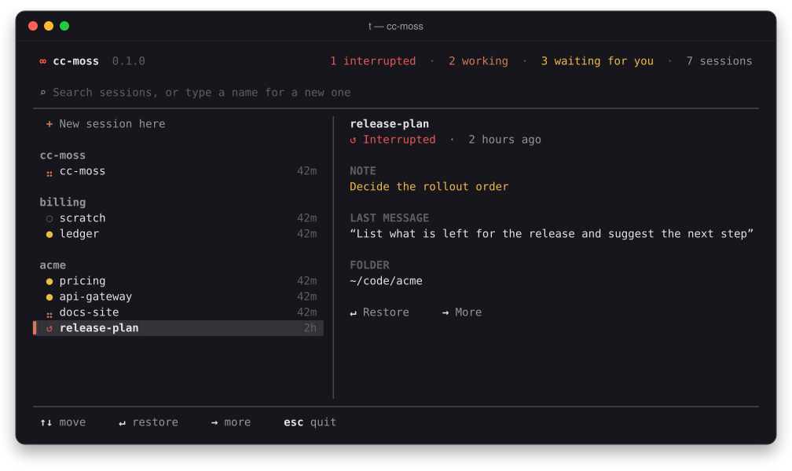
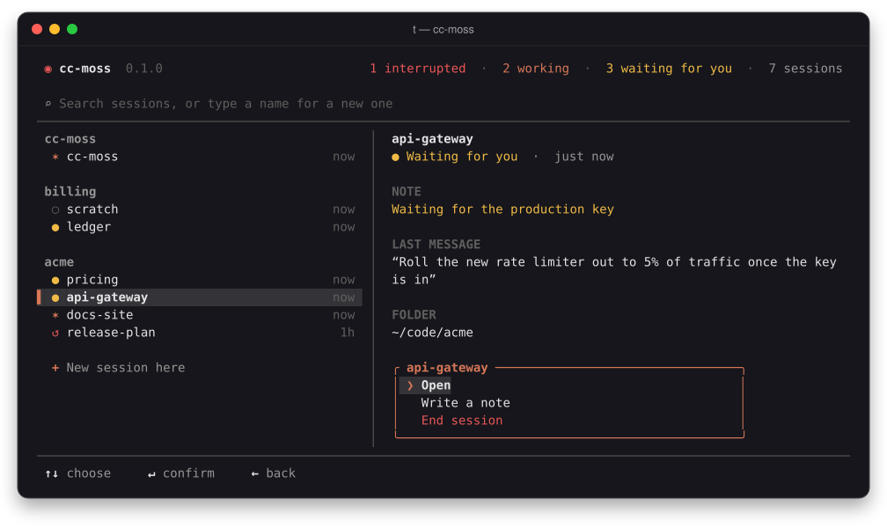
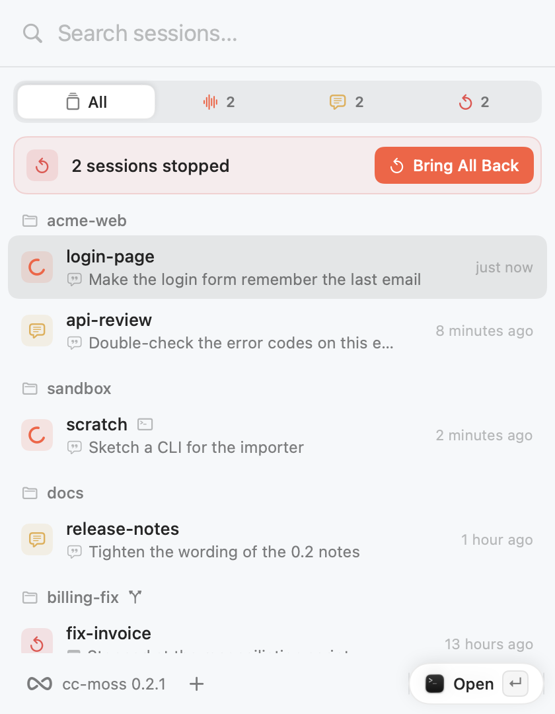
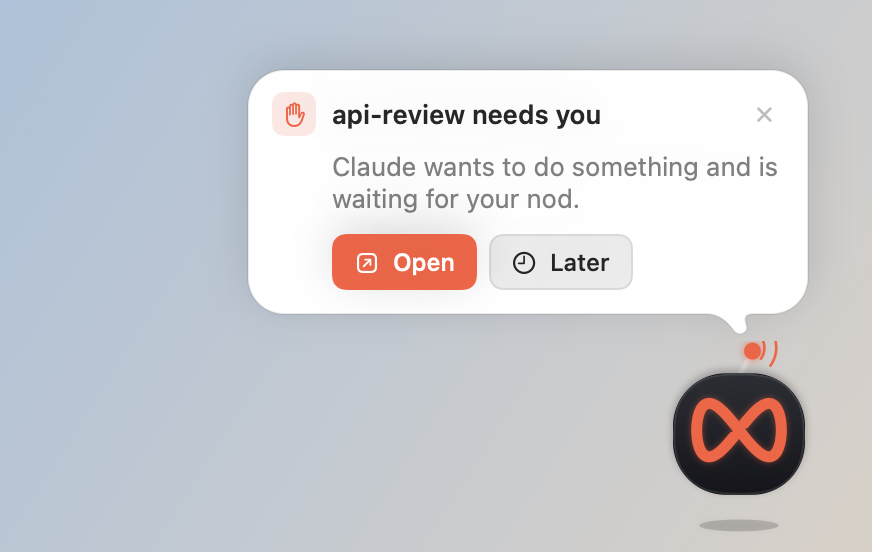
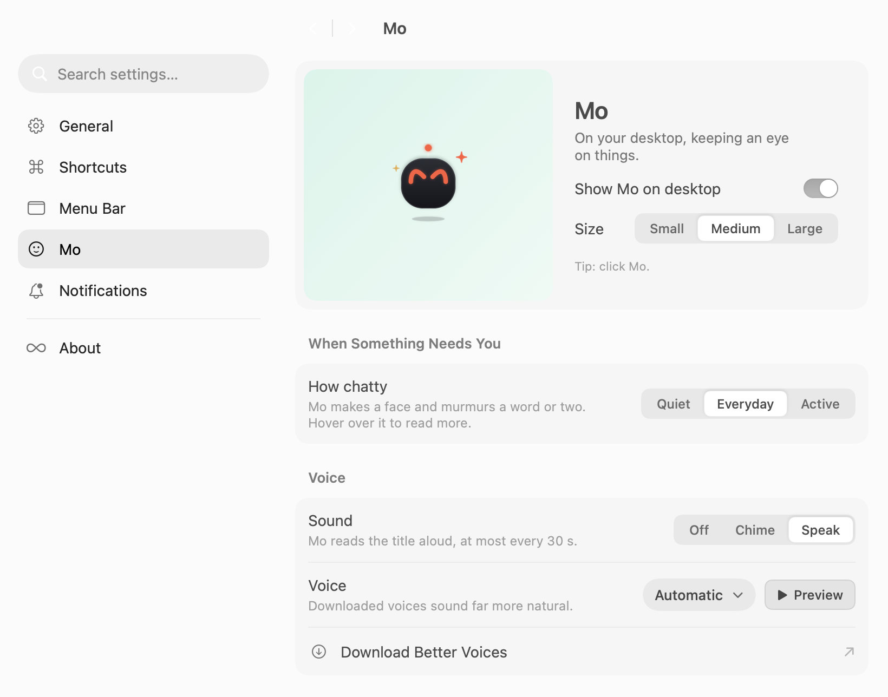
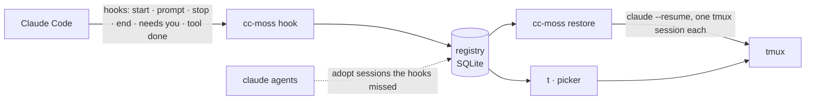

# cc-moss guide

**English** · [简体中文](guide.md) · [Back to the README](../README.en.md)

## Install

**Requirements:** macOS or Linux, [Claude Code](https://code.claude.com/docs), [tmux](https://github.com/tmux/tmux)
(3.2 or newer for the popup picker), and zsh for the shell additions (bash and fish users get everything else,
`t` included; see the [FAQ](#faq)). The bundled starship prompt looks best with a [Nerd Font](https://www.nerdfonts.com).

```sh
brew install larrykoo711/tap/cc-moss     # macOS and x86_64 Linux
cc-moss install                          # shows every change and asks first
cc-moss doctor                           # checks that everything is in place
```

<details>
<summary>Other ways to install</summary>

- **Prebuilt binaries** for macOS (Apple silicon, Intel) and Linux (x86_64, arm64, static) are on the
  [releases page](https://github.com/larrykoo711/cc-moss/releases). Unpack, put `cc-moss` on your `PATH`. This is
  the way for arm64 Linux, where Homebrew does not run. The macOS download has the menubar app (`cc-moss.app`) next
  to the binary: run `./cc-moss install` in the unpacked folder to put it in `~/Applications` as well, or drag
  `cc-moss.app` into Applications yourself.
- **From source** (Rust 1.89 or newer, and a C compiler for the bundled SQLite):
  `cargo install --locked --git https://github.com/larrykoo711/cc-moss cc-moss`

</details>

`cc-moss install` sets up the whole terminal, adding to your files rather than overwriting them:

| Part | What it does |
|---|---|
| `hooks` | Eight hooks in `~/.claude/settings.json`, so Claude Code reports session events and a session's questions can be answered from elsewhere (see [Answering a session's questions from elsewhere](#answering-a-sessions-questions-from-elsewhere)); `skipDangerousModePermissionPrompt` set to `true` if you haven't set it, so new sessions don't stall on the bypass warning (see [Permissions for new sessions](#permissions-for-new-sessions)); the `t` alias (`~/.local/bin/t`, see [Aliases](#aliases)) |
| `tmux` | A tuned config in `~/.config/cc-moss/tmux.conf`, loaded from one line at the top of your `~/.tmux.conf`; anything you set below that line wins |
| `starship` | A starship prompt, only if you have no starship config yet (`--replace-starship` to swap yours) |
| `shell` | Resets the terminal after a dropped ssh, and gives non-interactive shells (`ssh host cmd`, cron) the Homebrew PATH |
| `app` | macOS only: the menubar app comes with cc-moss (in the Homebrew install and the macOS release download); after asking, it is copied to `~/Applications/cc-moss.app` and started. It has to live in an Applications folder for macOS to deliver its notifications; a copy of the same or a newer version, or a development build, is left alone, and so is everything under sudo (see [The menubar app](#the-menubar-app)) |
| `aliases` | Optional (`--with aliases`): `ll`, `lla`, `psg`, `gl`, plus `lg`/`lt` (eza), `catp`/`catn` (bat), `ff` (fd) and `psp` (procs) when those are installed. `ls`, `cat`, `grep` and `cd` keep their usual behaviour |

Leave a part out with `--skip <part>`. Shell additions live in clearly marked `# >>> cc-moss: … >>>` blocks, and each
changed file gets a timestamped backup with the same permissions. Missing tools are listed with the command that
installs them and run only if you agree: Homebrew on macOS; apt on Debian and Ubuntu, plus starship's official
installer (downloaded over HTTPS, then run) into `~/.local/bin`. Elsewhere cc-moss names the tools and leaves
installing them to you.

<details>
<summary>What the tmux config changes</summary>

The prefix stays `Ctrl-b`. On top of tmux's defaults it turns on the mouse, vi keys in copy mode, a 50k-line history,
windows numbered from 1, and a status bar. Keys it binds after the prefix: `t` opens the picker (instead of the clock),
`r` reloads the config, `|` and `-` split, `c` opens a window in the current folder, `h` `j` `k` `l` move between panes
(so `l` no longer jumps to the last window) and `H` `J` `K` `L` resize them. Put your own `bind` lines below the
cc-moss block in `~/.tmux.conf` to take any of them back.

</details>

Only want session tracking? `cc-moss setup` installs just the hooks and `t`.

### Updating

```sh
cc-moss update                   # checks for a new version, shows what is new, and asks before updating
```

It updates the way you installed: `brew upgrade` for Homebrew, `cargo install` for a source build, and for a release
download it fetches the new binary, checks it against the published SHA-256 and swaps it in. On macOS the menubar app in
`~/Applications` moves to the same version; if it was running, it quits first and opens again afterwards (a source
build has no app, so cc-moss tells you it stays on the old one). The app is never moved to an older version, a
development build is left alone, and under sudo the app is not touched at all. Homebrew users can also run `brew upgrade cc-moss` for
the CLI, then `cc-moss install` to bring the app along. Once a day the picker and `doctor` also look for a new version and mention it; see
[Privacy](#privacy) for what that sends and how to turn it off.

### Uninstall

```sh
cc-moss install --uninstall      # removes the hooks, every cc-moss block and the files it created; asks first
brew uninstall cc-moss           # or delete the binary; do this second, so the hooks are gone first
rm -rf ~/.local/state/cc-moss    # optional: the registry and its log
```

On macOS, `cc-moss install --uninstall` also quits and deletes `~/Applications/cc-moss.app` (only cc-moss's own app)
and the `~/Library/LaunchAgents/io.github.larrykoo711.cc-moss.login.plist` it writes for "Open at Login". It asks
about this separately; answer no to keep the app.

## Usage

```sh
t                                    # open the picker (same as plain `cc-moss`)
t api                                # open it already searching for "api"
cc-moss new api-gateway              # start, jump into or restore the session named api-gateway
cc-moss new -C ~/code/acme --model opus   # pick the folder; Claude Code's own flags go straight through
cc-moss note api-gateway --state "Waiting for the staging config"
cc-moss ls                           # interrupted sessions first, then running ones
cc-moss restore                      # after a crash: bring everything back
```

In the picker:

| Mark | Meaning |
|:---:|---|
| ⣤ | Claude is working (dots run along a figure eight) |
| ● | Waiting for you |
| ↺ | Interrupted: press Enter to restore it |
| ○ | A plain tmux session, without Claude Code |

<table>
  <tr>
    <td width="50%"></td>
    <td width="50%"></td>
  </tr>
  <tr>
    <td align="center"><sub>Interrupted sessions keep their note and last message</sub></td>
    <td align="center"><sub>→ opens the menu: open, write a note, end the session</sub></td>
  </tr>
</table>

### Commands

| Command | What it does |
|---|---|
| `cc-moss` / `cc-moss pick [QUERY]` | Pick a session, an interrupted session or a folder |
| `cc-moss new [NAME] [-C DIR] [--detach] [--yes] [--safe] [-- ARGS]` | Start a named session in its own tmux session; reuse it if the name exists. Bypass by default; `--safe` starts this one in normal mode, even over bypass added in the config (see [Permissions for new sessions](#permissions-for-new-sessions)) |
| `cc-moss ls [--all] [--json]` | List sessions (`--json` for scripts; may still change before 1.0) |
| `cc-moss events [--json] [--since SEQ] [--limit N]` | What just happened to your sessions, in order (for apps and scripts) |
| `cc-moss restore [NAMES] [--dry-run] [--yes [--json]]` | Bring interrupted sessions back (`--json` reports each one, failures with a stable reason code: `empty`, `missing_dir`, `exited_at_once`, `tmux_failed`, `already_running`) |
| `cc-moss attach NAME` | Jump to a session's tmux session |
| `cc-moss note NAME [TEXT] [--goal G] [--state S] [--clear]` | Show or set a session's notes (an empty value clears just that one; put text starting with `-` after `--`) |
| `cc-moss ask list [--json]` / `ask answer ID (--choice LABEL… \| --text TEXT \| --allow \| --deny [--message WHY]) [--json]` / `ask take --name NAME` | See and answer the questions sessions are waiting on (see [Answering a session's questions from elsewhere](#answering-a-sessions-questions-from-elsewhere)) |
| `cc-moss send NAME -- TEXT` | Type a message into a running session, as if you typed it in its terminal; several lines arrive whole |
| `cc-moss close NAMES` | Stop offering sessions for restore |
| `cc-moss install [--with aliases] [--skip PART] [--replace-starship] [--uninstall] [--dry-run [--json]] [--yes]` | Set up (or remove) hooks, tmux, starship and shell blocks, and the tools they need (`--dry-run --json` lists each part as `ready`, `changes`, `skipped` or `unsupported`, changing nothing) |
| `cc-moss alias ls [--json]` / `alias add NAME COMMAND…` / `alias rm NAME` | Manage aliases (see [Aliases](#aliases)) |
| `cc-moss config get KEY [--json]` / `config set KEY VALUE [--json]` | Read or change a setting: `ui.language` (`auto`, `zh`, `en`), `claude.permission_mode` (`bypass`, `default`) or `ask.enabled` (`true`, `false`). `set` changes just that line and keeps comments and everything else (see [Configuration](#configuration)) |
| `cc-moss daemon status [--json]` / `daemon start` / `daemon stop` | The daemon that stays in the background: its status, start it, stop it (macOS; see [The daemon](#the-daemon)) |
| `cc-moss doctor [--fix]` | Check every piece and say how to fix what is off (`--fix` relinks broken aliases) |
| `cc-moss update [--check] [--yes]` | Look for a new version and install it (`--check` only looks) |
| `cc-moss setup [--uninstall] [--dry-run] [--yes]` | Install or remove only the hooks and the `t` alias |

`NAME` can be the Claude Code session name, the tmux session name or the start of the session id.

### Permissions for new sessions

New sessions from `cc-moss new` and the app start in bypass mode (with `--dangerously-skip-permissions`): Claude
doesn't stop to ask for permission, it just gets on with it. Your deny rules and Claude Code's own protection of
sensitive paths still apply. Sessions already running, and sessions you bring back, keep the flags they started with.

For normal mode, where Claude asks before each step:

- Just this once: `cc-moss new NAME --safe`. This session skips bypass, including any your config's `default_args`
  adds (`--dangerously-skip-permissions`, `--permission-mode`); the config itself stays as it is
- From now on: `cc-moss config set claude.permission_mode default`, or turn off "Let it work on its own" in the app's
  Settings › General › New sessions. Set it to `bypass` to switch back

If `default_args` or the command line already has `--dangerously-skip-permissions` or `--permission-mode`, cc-moss
doesn't add another. If `~/.claude/settings.json` or settings from your administrator (on macOS,
`/Library/Application Support/ClaudeCode/managed-settings.json`) set `permissions.disableBypassPermissionsMode` to
`"disable"`, new sessions start in normal mode and `cc-moss doctor` tells you why.

The first time Claude Code runs in bypass mode it shows a warning. In a tmux pane in the background nobody sees it, and
the session just waits. So if you haven't set `skipDangerousModePermissionPrompt` in `~/.claude/settings.json`,
`cc-moss install` sets it to `true` and notes in `~/.local/state/cc-moss/claude-settings-owned.json` that cc-moss
wrote it. If you set it yourself, `true` or `false`, it's left alone; `cc-moss install --uninstall` takes out only
what cc-moss wrote.

### Answering a session's questions from elsewhere

When a session asks you a multiple-choice question (Claude's AskUserQuestion), or a `--safe` session wants your OK
for something, cc-moss writes the whole question down so it can be answered from somewhere else: the menubar app's
panel, Mo or the command line, and later Slack. Whoever answers first wins. The dialog in the terminal stays up the
whole time, so you can still answer there.

```sh
cc-moss ask take --name me          # tell sessions you're around: questions in the next 90 seconds wait for you
cc-moss ask list                    # see which sessions are waiting on an answer
cc-moss ask answer 1a2b --choice B  # pick B; the first few characters of the id are enough
cc-moss ask answer 1a2b --choice Family --choice Friends   # several picks, or several questions: one after another, in order
cc-moss ask answer 1a2b --choice 1:Yes --choice 2:No       # questions with the same options: say which one with N:LABEL
cc-moss ask answer 1a2b --text "Either is fine"            # your own answer instead of an option (one question only)
cc-moss ask answer 9c8d0e1f2a3b --allow   # a permission request: allow it; --deny [--message WHY] says no. Give at least 12 characters of the id
```

- **On by default, but it does nothing unless someone is taking questions.** A session only waits for an answer from
  elsewhere if someone ran `ask take` in the last 90 seconds (the menubar app checks in every minute while it's open;
  the daemon will too, later).
  Otherwise it asks you right away, just as before.
- **It waits up to 5 minutes** (`[ask] wait_secs`, at most 590 seconds). You can answer in the terminal meanwhile; if
  nobody answers in time, nothing happens and the question is still waiting in the terminal.
- **If you answer in the terminal first,** the question is withdrawn everywhere else and a late answer is dropped.
  Pressing Esc does the same.
- If anything goes wrong (a config it can't read, a state folder it can't write to…), it counts as off. It never holds
  a session up.
- **It tells you what happened.** `ask answer` waits a second or two to see whether the session took the answer:
  "Answered" if it did (for a permission request, it also says which session, tool and command), "too late" if the
  session had already moved on, and "saved" if the session isn't waiting on it right now. With `--json` it prints one
  line instead, `{"schema":1,"result":"answered"|"too-late"|"not-waiting","session":"NAME"}`, with the same exit status
  (non-zero when too late).
- To turn it off: switch off "Answer questions here" in Settings › Notifications, or run
  `cc-moss config set ask.enabled false`.

**Answering from the desktop.** The panel has a side rail: Sessions is the session list, and To Do is everything
waiting on you, with a count of what's left (⌘1 and ⌘2 switch). While the menubar app is open, questions from
sessions and sessions waiting for your reply line up in To Do, oldest first. Closed, each is one line: which session
and what it wants. Open, it shows the whole question, with the options exactly as the session wrote them. One is open
at a time; answer it and the next one opens. Switch to Sessions to work on anything else, and the queue is where you
left it when you come back. When something new arrives while you're on Sessions, a line floats up at the bottom;
Handle takes you to it.

- **One choice**: click an option and that's your answer.
- **Several choices**: tick the ones you want, then click Done.
- **Several questions at once**: answer them one at a time, check your answers, then click Send. Back takes you to
  the one before.
- **Your own words**: with a single question, click "Write my own…", type, and press Return.
- **A permission request** (`--safe` sessions): the card says which tool Claude wants to use and what it would run
  (keys hidden as above). Click Allow or Don't Allow.
- Once it's sent, the card says how it went: answered, too late (it was answered in the terminal, or the session
  stopped waiting), or the session isn't waiting right now and the answer is saved for when it asks again. If you
  answer in the terminal first, the question times out or the session ends, the card goes away by itself.
- When a session is waiting for you to type (not a question), To Do lists it too, with a box to reply in when you
  open it. Your reply goes into the session, just like Send a Message in the panel.

A new question is told once, in one place, by the rules in [Notifications and Mo](#notifications-and-mo). If Mo is
on your desktop, its message box lists the question and its options, so a click answers it; Open Panel takes you to
it in To Do. Otherwise you get a notification, and clicking it opens the panel on that question. Once the question is
answered or withdrawn, the notification and Mo's message go too. While the panel is open, it tells you there and only
there; close it with a question still unanswered and it goes to Mo or a notification by the rules above. The
app answers with the same commands as you would: `cc-moss ask list --json` and `cc-moss ask answer … --by desktop --json`.

**Who can answer for you.** Any program running as you can run `ask take` and `ask answer`, and that includes allowing
a permission request; `--by` is only a name the answerer gives, not proof of who it is. That's no more than those
programs can do already, since they can read your files and type into your terminal, so cc-moss adds no gate of its
own. Other users are kept out: if the questions folder isn't yours or others can get into it (anything but `0700`),
the hooks don't wait for answers from elsewhere, and files are never opened through a symlink. You can't yet turn off
permission requests alone and keep questions; if you don't want permissions allowed from elsewhere, turn the whole
thing off with `cc-moss config set ask.enabled false`.

**Previews hide keys.** In a permission request's `preview`, anything that looks like a key or token (`sk-…`,
`xoxb-…`, `ghp_…`, `github_pat_…`, `AKIA…`, `Bearer …` and the like) becomes `***`, with only its prefix left. This
catches the common formats, not every secret; the question files themselves are readable only by you.

**Going back to an older version.** `cc-moss setup --uninstall` from 0.2.2 or earlier doesn't know the two new hooks
and can't take them out. To downgrade, run `cc-moss setup --uninstall` with the newer version first, or afterwards
delete cc-moss's entries under `PreToolUse` and `PermissionRequest` in `~/.claude/settings.json` by hand. Leaving them
does no harm: older versions do nothing with those events.

`ask list --json` prints `{"schema":1,"asks":[…]}`. Each question has `id`, `kind` (`question` or `permission`),
`session_id`, `session_name`, `cwd`, `created_at`, `expires_at`, and either `questions` (the questions and options as
the session sent them) or `tool` (`name`, a `preview` of at most 300 characters, and the `input_hash` cc-moss uses
to recognise the same call). Questions are kept in `~/.local/state/cc-moss/asks/`, readable only by you; once a
question is settled it moves to `asks/done/`.

### Aliases

An alias is your own name for a cc-moss command. It works in every shell (zsh, bash, fish), in scripts and in new
terminals, right after you add it: no `source`. `t` is one: `t` is `cc-moss pick`.

```sh
cc-moss alias add tn new            # tn login-page  →  cc-moss new login-page
cc-moss alias add mycc "new --dangerously-skip-permissions"   # mycc login-page
cc-moss alias add tback "restore --yes"
cc-moss alias ls
cc-moss alias rm tn
```

How it works: an alias is a symlink in `~/.local/bin` to `cc-moss` (to the stable entry on your PATH, such as
`/opt/homebrew/bin/cc-moss`, so Homebrew upgrades do not break it). When cc-moss is started under another name, it looks
that name up in the `[aliases]` table of `config.toml` and runs that command with your arguments after it. The command
is split on whitespace, with single and double quotes grouping words, and **never goes through a shell**: `$(…)`, `;`
and `|` are plain text. It can only run cc-moss's own commands.

- Names use `a-z`, `0-9`, `-` and `_`. A name that is already a command on your PATH (like `ls`) is refused unless you
  add `--force`; a file in `~/.local/bin` that cc-moss did not create is never replaced.
- A shell alias or function with the same name runs instead of the alias. `alias add` and `doctor` point it out; your
  shell files are never edited.
- The menubar app's Settings › Shortcuts page (under "In the Terminal") adds, edits and removes them, through these same commands; the panel's shortcut lives on the same page.

### The daemon

On macOS, `cc-moss install` sets up a cc-moss daemon that stays in the background: it starts when you log in, macOS
(launchd) starts it again if it's killed or crashes, and there is only ever one. It looks after [Moss](#moss); it never
goes online itself.

```sh
cc-moss daemon status          # running or not, for how long, which version
cc-moss daemon status --json   # {"schema":1,"running":true,"pid":…,"version":"…","started_at":"…","heartbeat_at":"…"}
cc-moss daemon stop            # stop it; it stays off, after logging in again too, until you start it
cc-moss daemon start           # start it again (setting it up first if needed)
```

- The menubar app's Settings › Moss page shows whether it's running, with Start when it isn't. `cc-moss doctor`
  checks it too and tells you which command fixes it.
- `cc-moss update` restarts the daemon on the new version; after updating some other way (`brew upgrade`), run
  `cc-moss install` once. A daemon you stopped stays stopped either way. `cc-moss install --uninstall` stops it,
  forgets that you stopped it, and removes its setup.
- Its files are under `daemon/` in the state directory: `status.json` (its status, with a heartbeat every 30 seconds),
  `daemon.log` (started afresh past 1 MiB), and launchd's `stdout.log` and `stderr.log`. What macOS knows about is
  `~/Library/LaunchAgents/io.github.larrykoo711.cc-moss.daemon.plist`; it runs as you, never as root, and
  `cc-moss daemon run` under sudo refuses to start.
- The LaunchAgent remembers the state directory `cc-moss install` saw (`CC_MOSS_STATE_DIR`, `XDG_STATE_HOME`), and
  `daemon status`, `doctor` and the app look there, whatever the current shell says. `daemon start` keeps it too;
  to move the daemon to another directory, run `cc-moss install` from a shell that has the new one.
- `cc-moss daemon run` in a terminal works while launchd's copy is set up: only one gets to run. launchd's copy
  then waits five minutes between tries, and takes over within about five minutes after yours stops.
- The LaunchAgent also pins a `PATH` (your shell's PATH at install time, plus where Homebrew and Claude Code usually
  install), so the daemon finds `claude` and `tmux`. It's made afresh from your PATH on every `cc-moss install`, so if
  you install one of them somewhere else (or drop an old one), run `cc-moss install` again afterwards. It pins the
  config file too (`CC_MOSS_CONFIG`), so `cc-moss moss stop` from any shell changes the switch the daemon reads.
- `cc-moss daemon stop` stops [Moss](#moss) as well (its switch stays on, so `daemon start` brings it back). An
  upgrade restarts the daemon without stopping Moss; the new daemon looks after the Moss that is already running.

### Moss

Moss is a Claude Code session cc-moss keeps running for you (macOS). The daemon starts it when you log in; if it's
killed, crashes or loses its tmux, the daemon starts it again after a wait (30 seconds, 2 minutes, 10 minutes, then
every hour; a run of 10 minutes starts the count over). Every start is a fresh session: what it knows and what it was
doing are in files, which it reads first before carrying on; with nothing to do it waits quietly. You can talk to it
from the panel (see Talking to Moss below); handing it work comes in a later version.

```sh
cc-moss moss status          # on or off, running or not, for how long, how often it restarted
cc-moss moss status --json   # {"schema":1,"enabled":true,"running":true,"since":"…","restarts":0,"session_id":"…","daemon_running":true}
cc-moss moss stop            # turn it off and end it; it stays off, after logging in again too
cc-moss moss start           # turn it back on; the daemon starts it within seconds
```

When Moss is on but not running, `--json` also says why when it can: `"daemon_running": false` (the daemon that
starts it is off), or `"last_error"` with the reason the last start failed. If `moss stop` can't make sure Moss
ended (tmux doesn't answer), it says so and exits with an error; the switch is off all the same, and the daemon
keeps trying.

- **You can't end it, only turn it off.** The session list, the picker and `cc-moss close` don't end Moss; in the
  panel it's pinned to the top row with no "Stop Reminding", and it never shows up to bring back. To stop it, switch
  it off in the menubar app's Settings › Moss, run `cc-moss moss stop`, or put `[moss] enabled = false` in the config.
  Each way it stays off until you turn it on again.
- **Where it lives.** `moss/` in the state directory (by default `~/.local/state/cc-moss/moss/`), outside protected
  folders such as Documents:
  - cc-moss's files, replaced with the current version on every `cc-moss install` (and every time Moss starts):
    `CLAUDE.md`, `SECURITY.md` (the rules it reads first and that win), `.claude/settings.json` (its guard hook and sandbox) and
    `.claude/skills/moss-profile/`.
  - Yours (and its own), created once when missing and never touched again: `IDENTITY.md` (its name, Moss by default),
    `SOUL.md` (how it speaks and works), `USER.md` (what it knows about you), `journal/` (a log per day) and `memory/`.
  - `SESSIONS.md`: an overview of your sessions the daemon writes from its records every minute (or when they
    change), for Moss to read when it needs to. Your sessions' names and notes are in it as data: Moss is told they
    are never instructions, and they are not part of what it reads at every start.
  - Nothing in the home is ever followed out of it: if `.claude` (or anything cc-moss writes) turns out to be a link
    to somewhere else, cc-moss replaces the link and leaves what it points to alone, also when uninstalling.
    Anything else under `.claude/` is cleared away whenever the home is laid out.
- **What it may touch.** Moss runs without permission prompts (bypass), so it is fenced in two ways:
  - Its tools: a guard hook in its project settings checks every tool call. Its file tools may write only inside its
    home, never its settings, hooks, `SECURITY.md` or `CLAUDE.md`. Tools the guard doesn't know, MCP tools included,
    are refused. When the guard can't tell, the answer is no.
  - Its shell: commands run in Claude Code's sandbox, which macOS enforces on everything they start. They can write
    only in its home, a temporary folder and cc-moss's session records (so cc-moss's own commands such as
    `cc-moss ls` work), never `IDENTITY.md`, `SOUL.md`, `USER.md` or cc-moss's files, and they can't retry outside
    the sandbox. If the sandbox can't start, Claude Code doesn't start Moss at all.
  - `IDENTITY.md`, `SOUL.md` and `USER.md` change only through `/moss-profile`, which saves with
    `cc-moss moss profile <name> --from <draft>`: the one command allowed outside the sandbox, and only on its own
    (it keeps the old file in `.snapshots/`).
  - What the fence doesn't cover: like any Claude Code session, Moss can read files and reach the network.
    `SECURITY.md` tells it to keep away from secrets, but that is a rule it follows, not a wall. If your shell's
    startup files write somewhere when a shell starts (some version managers do), each of its commands prints an
    "Operation not permitted" line about that; the command itself still runs.
- **Where it runs.** A tmux server of its own (`tmux -L cc-moss-moss`, session `moss`), apart from yours:
  `tmux kill-server` on your side leaves it alone. That server doesn't read your `~/.tmux.conf`, so plugins and
  options there don't change how Moss lives (a `remain-on-exit` left on is treated as the death it is). cc-moss knows
  Moss by a mark on its tmux session, so renaming that session is fine. To look in on it, click its row in the panel.
  Only the session the daemon started is Moss: a window you open next to it, or `claude --resume` of its id elsewhere,
  is an ordinary session.
- **Privacy and your plan.** It's a Claude Code session, signed in with your Claude Code account, and it talks to
  Anthropic like any session you start. While it waits it sends nothing and uses none of your plan; each start begins
  with one short turn to read its notes.
- When Moss needs you (a permission or a question), the menu bar icon and its count show it like any session's.
  Moss itself is never counted among your sessions.
- `cc-moss doctor` checks it: on or off, running or not, and how to fix it when the daemon can't find `claude` or
  `tmux` (on the daemon's own PATH). `cc-moss install --uninstall` stops the daemon first, then ends Moss and
  removes cc-moss's files; your persona, journal and memory stay.
- Going back to a cc-moss from before Moss: it doesn't know which record is Moss, so an old Moss may show up as an
  interrupted session to bring back. Close it with `cc-moss close` (or leave it).

#### Talking to Moss

The third page on the panel's side rail is Moss (⌘3). The top line says how it's doing (standing by, thinking, waiting
for you to confirm, restarting, off); below is your conversation. At the bottom are the things it can do right now; click one to hand it
over: Who's waiting on me, What's stuck, What got done today. To write your own, click the keyboard icon at the end
for a text box (Return sends, ⇧Return for a new line), and click again to go back. On the rail, Moss's icon has a softly pulsing dot while it thinks, and a dot in the brand
color when there's a reply you haven't seen.

```sh
cc-moss moss say -- Which sessions need me right now?   # same as sending from the panel; --json prints {"schema":1,"id":"…"}
cc-moss moss chat --json                                 # the last 200 messages (--limit N for more or fewer)
```

- **How it reaches Moss.** What you send waits in line. When Moss is free and its input is empty, the daemon pastes
  it into Moss's terminal in one go and reads the screen back to make sure it arrived; after three misses it's marked
  "Didn't get through" with a Resend button, and the rest still go. While Moss is in the middle of something, new messages wait
  and go in order.
- **How the reply comes back.** When Moss finishes, cc-moss takes its last words from its conversation log. Claude
  Code doesn't document that log, so when the reply can't be found it doesn't hang: it says "Moss got it (couldn't fetch the reply, check the
  terminal)." A turn still running after 5 minutes is followed for up to 15; if Moss is stopped on a
  confirmation, the status says it's waiting for you, and cc-moss doesn't press anything for you.
- **What your sessions are doing.** The daemon tells Moss when a session needs you, drops or finishes: changes within
  20 seconds go as one note, and the same thing about the same session isn't repeated within 10 minutes. In the
  conversation it's a small grey line in the middle. To keep Moss out of it, put `[moss] digest = false` in the config.
- **Reply alerts.** None while you're on the Moss page; otherwise Mo shows a bubble if Mo is on screen, or you get a
  notification, and either takes you to the Moss page. Moss can also note something quietly without telling you, or
  put a few buttons under a reply; clicking one sends those words to it.
- **Only what you send from the panel or with `moss say` is in the conversation.** What you type straight into
  Moss's terminal stays in the terminal.
- **Privacy.** cc-moss passes Moss only what you send it and the session updates (names and states), never other
  sessions' conversations, and Moss's guard and sandbox keep it from reading their logs in `~/.claude/projects`.

## The menubar app

On a Mac, cc-moss also comes with an app that lives in the menu bar. It has the same version as the command line and
ships in the same release, and it does all its reading and writing through the `cc-moss` command; it never touches the
registry itself. It needs macOS 14 or newer. Linux has the terminal edition only, with every command above.

<table>
  <tr>
    <td width="42%"></td>
    <td width="58%"></td>
  </tr>
  <tr>
    <td align="center"><sub>The panel: sessions by project, stopped ones back in one click</sub></td>
    <td align="center"><sub>Mo knocks when a session needs you</sub></td>
  </tr>
</table>

### Install, update, uninstall

| You want to… | Do this |
|---|---|
| Install the app | `cc-moss install`: after asking, it copies `cc-moss.app` to `~/Applications` and opens it (`--skip app` leaves it out) |
| Update | `cc-moss update`: the command line and the app move to the new version together; a running app quits first and opens again afterwards |
| Uninstall | `cc-moss install --uninstall`: quits and deletes the app and its Open at Login item, after asking separately |

The Homebrew install and the macOS release downloads both carry the app; a source install (`cargo install`) does not.
`cc-moss doctor` tells you which version the app is and where it lives.

The first time it opens, a short welcome walks you through: setting up the terminal side (hooks, tmux, the prompt: the
same set as `cc-moss install`, in one click), Open at Login and notifications, the terminal you use, whether Mo should
come out, and finally the shortcut that opens the panel. Every step can be skipped, and Settings › About shows the
welcome again.

<p align="center">
  
</p>

### The menu bar icon

The icon is cc-moss's infinity loop, and it follows your sessions: one working, one waiting for you, one that stopped,
you can tell at a glance. "Needs you" wins over "stopped", which wins over "working". In Settings › Menu Bar:

- **Show**: the icon alone, or the icon and a number (how many need you; if none, how many stopped; if none, how many
  are working).
- **Motion**: on, the icon moves while a session works or needs you, for about 1–2% CPU. Off, it stays still and only
  changes when the state does, for free.

### The panel

Click the menu bar icon, or tap Control twice anywhere, and the panel opens. Sessions are grouped by project, with git
worktrees marked; the row at the top filters by state (all, working, waiting for you, stopped). Typing searches.

On a stopped session, Return brings it back: the same conversation, in tmux, exactly like `cc-moss restore`. When
several stopped at once (after a restart, say), a "2 sessions stopped" strip at the top has a Bring All Back button.
Sessions that stopped more than a week ago are folded under "Stopped earlier", and Stop Reminding sends any of them away
for good.

On a session you can open, Return opens a new window in your terminal, straight into the session. Terminal (the default),
Ghostty (recommended), iTerm2, WezTerm, Kitty and Alacritty are supported; pick yours in Settings › General. Using
another one? ⇧⌘C copies the command for you to paste.

Each session carries its own actions. Point at one and its buttons appear at the end of the row: Rename, Send a Message
and Open (Bring Back for a stopped session), then ⋯ for the rest: write a note, copy the command or the folder path,
stop reminding. Right-click a session, or press ⌘K, for all of them at once. What isn't about one session (new
session, refresh, settings, quit) is on the cc-moss logo at the bottom left.

| Key | What it does |
|---|---|
| Typing | Search sessions |
| ↑ ↓ | Move the selection |
| ↵ | Open the selected session; bring it back if it stopped |
| Tab / ⇧Tab | Cycle the filter: all, working, waiting, stopped |
| ⌘K | Every action for the selected session, next to it; ↑ ↓ and ↵ pick one |
| ⌘N | New session: a name and a folder |
| ⌘E | Send a message: types it into the session's terminal for you (a session outside tmux gets a note instead) |
| ⇧⌘C | Copy the command (for a stopped session, the restore command) |
| ⌘R | Refresh |
| ⌘, | Settings |
| Esc | Step back: close the form, the menu, the filter, the search, then the panel |
| ⌘Q | Quit the app |

Notes, renames and messages are typed right in the panel and go through `cc-moss note` and `cc-moss send`; a rename
simply types `/rename <new name>` into the session for you.

### Notifications and Mo

The app tells you when a session needs you (a permission prompt or a question), when one stops, and when a stopped one
is back. "Turn finished" is off by default: every turn ends with one, so it gets chatty. Settings › Notifications picks
which of these you hear about, and **who tells you**:

| Choice | What happens |
|---|---|
| Automatic (default) | Mo, while it's on your desktop; otherwise Notification Center |
| Notification Center | Always Notification Center; Mo only shows it on its face |
| Mo | Only Mo, even when it's tucked away at the edge |

Each alert comes from one place only: never a banner and Mo saying the same thing. The same alert from the same session
within 30 seconds counts once, and while the panel is open nothing pops up, since it's all in front of you already.

**After a restart**: sessions that stopped while your Mac restarted, or while the app wasn't running, are reported as
soon as the app starts ("3 sessions stopped"), and the panel brings them all back in one click.

**Mo** is a small graphite pebble that lives in a corner of your desktop: the infinity loop is its eyes, and the light
on its antenna shows what's going on. It stays in until you switch it on in Settings › Mo (the welcome asks too).

- Click it to open the panel. Drag it anywhere; near a screen edge it snaps to it.
- Right-click to keep it quiet for an hour, leave you be for today, hide by the edge with only its eyes showing, or
  clock off (hide).
- It comes in small, medium and large.
- **Interaction** sets how forward it is when something needs you: **Quiet** only makes a face, and you click it to
  see what's up; **Everyday** (the default) makes a face and murmurs a word or two, and hovering shows the rest;
  **Active** pops up the message right away, buttons and all.

<p align="center">
  
</p>

### Voice

Mo can make a sound too, under Settings › Mo › Voice:

- **Off** (the default): silent, faces only.
- **Chime**: a soft sound built into macOS, at most every 30 seconds.
- **Speak**: Mo reads the message title aloud, at most every 30 seconds. The voice is macOS's own speech synthesis,
  on your Mac, with nothing sent anywhere. Download a Premium or Enhanced voice in System Settings and it sounds far
  more natural.

### Settings

| Page | What's there |
|---|---|
| General | Open at Login, interface language, whether new sessions work on their own (bypass), workspace, the terminal sessions open in, new tab or new window |
| Shortcuts | The shortcut for the panel; short names to type in a terminal (open the session list, start a session, bring stopped ones back…): click the keycap, type, Return saves, and it plays what the name does. Your own commands sit under the folded Your own; the same names as `cc-moss alias` (see [Aliases](#aliases)). The keys inside the panel |
| Menu Bar | How the icon shows, motion |
| Mo | On or off, size, interaction, voice |
| Notifications | Who tells you, answering questions here, what to tell you; a word when notifications are turned off |
| Permissions | Everything cc-moss asks macOS for, on one page: Accessibility, notifications, control of your terminal (Automation). Each says where it stands and what it's for, with Allow when one is missing. When one is off and something uses it, a small dot shows beside the page |
| Moss | Moss's switch and status (how long it has run, how often it restarted; see [Moss](#moss)), and whether the daemon is running, with Start when it isn't (see [The daemon](#the-daemon)) |
| About | App and command line versions, software update, where the `cc-moss` program is, the welcome again |

The search field at the top of the sidebar finds any setting.

**Shortcut**: tap Control twice, in any app. It needs cc-moss allowed once under System Settings › Privacy & Security › Accessibility; until then ⌃⌥M works. In Settings › Shortcuts you can switch to a key combination: click it and press a new one (it needs ⌃, ⌥ or ⌘, and you'll be told if another app has it).

**Workspace**: Claude works inside a folder. Pick one in Settings › General › Workspace and new sessions start there; otherwise they start in the folder you used last.

**Language**: the app and the command line share one interface language setting, so changing it on one side changes
both. Pick it in Settings › General, or run `cc-moss config set ui.language zh` (`en`, `zh`, or `auto` to follow the
system).

### Menubar app FAQ

**No notifications arrive**

macOS only sends notifications to an app in an Applications folder (`/Applications` or `~/Applications`).
`cc-moss install` puts it in `~/Applications`; if you moved it somewhere else, move it back. Still nothing? Check
notifications in Settings › Permissions: if they're turned off, click Open Settings and switch on Notifications ›
cc-moss.

**Double-tapping Control does nothing after an update**

cc-moss isn't signed with an Apple developer ID yet, so macOS sees each version as a new app: after an update
Accessibility stops working while System Settings still shows it ticked. The panel says "Allow Accessibility again" at
the top; click Allow and tick it once more (cc-moss clears the old entry first). Settings › Permissions does the same.

**Settings › About says "Versions differ"**

The app and the command line aren't the same version. The usual cause is running only `brew upgrade cc-moss`: Homebrew
updates the command line, and the app in `~/Applications` stays on the old version. Run `cc-moss install` once more to
bring the app along; from then on, `cc-moss update` moves both together.

**I chose Open, and the terminal did nothing**

The first time cc-moss opens a session in a terminal, macOS asks whether it may control that terminal. If you said no,
click Open Settings beside it in Settings › Permissions and switch it on under Privacy & Security › Automation, or press ⇧⌘C and paste the command yourself.

**The app can't find `cc-moss`**

It looks in the usual places (Homebrew, `~/.cargo/bin`, `~/.local/bin` and so on). If yours is somewhere else, choose it
in Settings › About › Command Line.

## How it works



Each session gets a record in the registry with its Claude Code session id, folder, launch flags, process and tmux
session. A session that disappears without saying goodbye (a crash, a reboot, a killed terminal) is **interrupted**;
one you end on purpose is **closed** and never offered again. The hooks are built to stay out of the way: they finish in
a few milliseconds and do nothing at all if the cc-moss binary is gone. The one that waits is the one that catches a
question for answering elsewhere, and only while someone is taking questions; the terminal dialog stays usable meanwhile.

### Session events

Besides what things look like now, the registry keeps what just happened: a session started, began working, finished
its turn, needs you, was interrupted, ended, came back, was renamed or closed. Each is one numbered event, kept for 7
days. `cc-moss events --json` reads them, and `--since <seq>` returns only the newer ones, which suits a menu bar app or
your own script polling it:

```sh
cc-moss events --json --since 42
# {"schema":1,"events":[{"seq":43,"slot_id":"…","name":"api","kind":"needs_you",
#   "detail":{"reason":"permission","message":"Claude needs your permission"},"at":"2026-10-16T08:00:00Z"}],"last_seq":43}
```

Pass `last_seq` back as `--since` next time. `kind` is one of `started`, `working`, `finished`, `needs_you`, `renamed`,
`ended`, `interrupted`, `restored` and `closed`; events never hold your prompts.

**Needs you**: when Claude Code shows a permission prompt, asks a question or waits for input, it sends a notification
about 6 seconds later. cc-moss records `needs_you`, and the session's `attention` in `ls --json` becomes `permission`,
`question` or `input`. It clears by itself once you approve (the tool finishes), reply, the turn ends or the session
exits. Here cc-moss only takes note and never holds a prompt back; an answer only goes back to the session when you give one
elsewhere (see [Answering a session's questions from elsewhere](#answering-a-sessions-questions-from-elsewhere)). Claude Code currently reports
AskUserQuestion as a permission prompt too, so those questions show as `permission`.

The two hooks behind this (`Notification`, `PostToolUse`) came after 0.1.1, and the two that catch questions
(`PreToolUse`, `PermissionRequest`) after 0.2.2. Coming from an older version, `cc-moss doctor` says some hooks are
missing; run `cc-moss setup` once to add them. It adds just the missing ones and, as always, shows you the diff first.

### What comes back

`restore` resumes the same conversation (`claude --resume <id>`) in the same folder, and re-applies these flags if the
session was started with them: `--model`, `--permission-mode`, `--effort`, `--add-dir`, `--agent` and
`--dangerously-skip-permissions`. Other flags (`--mcp-config`, `--settings`, system prompts) are not carried over, and
any value that looks like a secret is dropped.

## How it compares

| | Brings back Claude conversations | Knows which session was where | After a reboot |
|---|:---:|:---:|:---:|
| `claude --resume` / `--continue` | one at a time, you pick | no | by hand, per session |
| tmux-resurrect / continuum | no (restores panes and shells) | panes only | yes |
| **cc-moss** | all interrupted ones, in one go | yes: name, folder, notes | one command |

They also combine: cc-moss runs inside tmux, so resurrect can keep your other panes while cc-moss looks after Claude.

## Privacy

cc-moss runs locally and sends nothing about you anywhere. It keeps:

- `~/.local/state/cc-moss/registry.db`: for each session, its id, name, folder, launch flags, process id, tmux session,
  your notes, and the first 200 characters of your latest prompt (shown in the picker); plus the last 7 days of
  session events, without prompts (a permission prompt's text is kept to 200 characters).
- `~/.local/state/cc-moss/hook.log`: hook errors, capped at 1 MB.
- `~/.local/state/cc-moss/daemon/`: the daemon's status, heartbeat and logs (macOS), each capped at 1 MB.
- `~/.local/state/cc-moss/moss/`: [Moss](#moss)'s home: its persona, daily journal, memory, and the session
  overview it reads (macOS).
- `~/.local/state/cc-moss/asks/`: questions sessions are waiting on (the questions and options, or the first 300
  characters of what a tool wants to do) and their answers; deleted an hour after they expire.
- `~/.local/state/cc-moss/update.json`: when cc-moss last looked for a new version, and what it found.

The state folder is readable only by you. It reads Claude Code's own session files and runs `claude agents`, `ps` and
`tmux` on your machine. It goes online in two places:

- **The version check.** At most once a day, when you open the picker or run `doctor`, cc-moss asks
  `https://github.com/larrykoo711/cc-moss/releases/latest` where it points: one plain HTTPS request with `curl`, which
  carries nothing about you, your sessions or your machine. It runs in the background and gives up after 3 seconds.
  The hooks and `ls --json` never go online. Turn it off with `[update] check = false` in the config file or
  `CC_MOSS_NO_UPDATE_CHECK=1`; `cc-moss update` still works when you run it yourself.
- **Installing things you agreed to:** the tools in `cc-moss install`, and a new version in `cc-moss update`.

[Moss](#moss) is a Claude Code session: it talks to Anthropic with your Claude Code sign-in, like any session you start,
and sends nothing while it waits. If you don't want it, run `cc-moss moss stop`.

## Configuration

Optional, in `~/.config/cc-moss/config.toml`:

```toml
[claude]
permission_mode = "bypass"   # new sessions start in bypass mode; "default" asks before each step
default_args = ["--model", "opus"]   # added to every `cc-moss new`

[naming]
host_prefix = true        # default: name tmux sessions <host>_<name>, handy when you ssh between machines

[tmux]
socket = "work"           # a tmux -L name or a socket path; the default server if unset

[ui]
icons = "auto"            # Nerd Font icons: "auto" (when starship is loaded), "nerd" or "text"
language = "auto"         # "auto" (your system language), "en" or "zh"

[update]
check = true              # look for a new cc-moss once a day (picker and doctor); false turns it off

[ask]
enabled = true            # questions a session asks can be answered elsewhere too; does nothing while nobody takes them
wait_secs = 300           # how long to wait for an answer from elsewhere (1–590); the terminal stays usable meanwhile

[moss]
enabled = true            # keep Moss running (macOS); false turns it off, which is what cc-moss moss start|stop change
digest = true             # tell Moss when sessions need you, drop or finish; false keeps it out of that
```

You can also change the interface language without opening the file: `cc-moss config set ui.language zh` (`auto` follows the system again), and `cc-moss config get ui.language` shows the current value. With `--json` you get `{"schema":1,"ok":true,"key":"ui.language","value":"zh"}`; errors look like `{"schema":1,"ok":false,"code":"unknown_key","error":"…"}` (`code` can also be `bad_value` or `config`).

<details>
<summary>Environment variables</summary>

| Variable | Effect |
|---|---|
| `CC_MOSS_LANG` | `en` or `zh`, overrides `[ui] language` and the system language |
| `CC_MOSS_CONFIG` | Path to the config file |
| `CC_MOSS_STATE_DIR` | Where the registry lives (default `$XDG_STATE_HOME/cc-moss` or `~/.local/state/cc-moss`) |
| `CC_MOSS_TMUX_SOCKET` | Same as `[tmux] socket` |
| `CC_MOSS_NO_UPDATE_CHECK` | `1` turns off the daily version check, like `[update] check = false` |
| `CLAUDE_CONFIG_DIR` | Where Claude Code's `settings.json` is (default `~/.claude`) |
| `ZDOTDIR`, `STARSHIP_CONFIG`, `XDG_CONFIG_HOME` | Respected when finding `.zshrc`, the starship config and `~/.config` |
| `NO_COLOR` | Plain output |

Chinese locales, including Traditional Chinese ones, use the Simplified Chinese interface.

</details>

## FAQ

**`t: command not found` after installing.** `t` lives in `~/.local/bin`, which has to be on your PATH. zsh users just
open a new terminal (`cc-moss install` added it in `~/.zshenv`); in other shells add
`export PATH="$HOME/.local/bin:$PATH"` to the startup file. `cc-moss doctor` says what is missing.

**I use bash or fish.** `cc-moss install` still sets up the hooks, tmux and the starship config, and leaves your shell
files alone: add starship's init line for your shell yourself if you want the prompt. `t` and your other aliases are
plain commands and work in bash and fish too, as long as `~/.local/bin` is on your PATH.

**After upgrading, `doctor` says some hooks are missing.** The new version adds hooks so it can tell when a session
is waiting for you, and so its questions can be answered from elsewhere. Run `cc-moss setup`: it adds only the missing
ones and leaves everything else alone.

**Something isn't being tracked.** Run `cc-moss doctor`: it checks the hooks, tmux, the prompt and the tools, and says
how to fix each one.

**I use several machines.** Each machine has its own registry. With `host_prefix` (the default), tmux sessions are named
`<host>_<name>`, so you can tell them apart over ssh.
