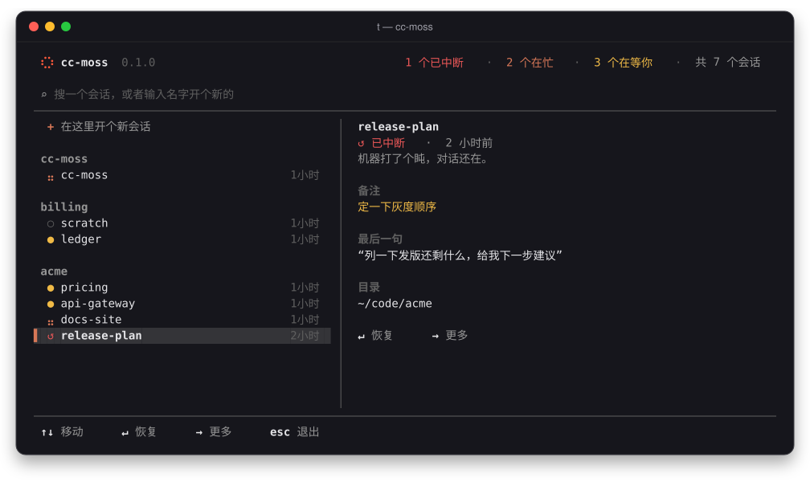
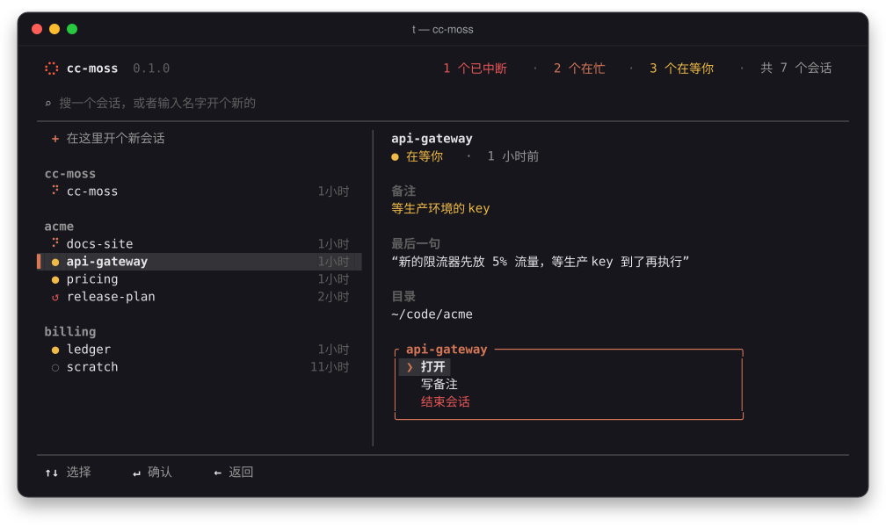
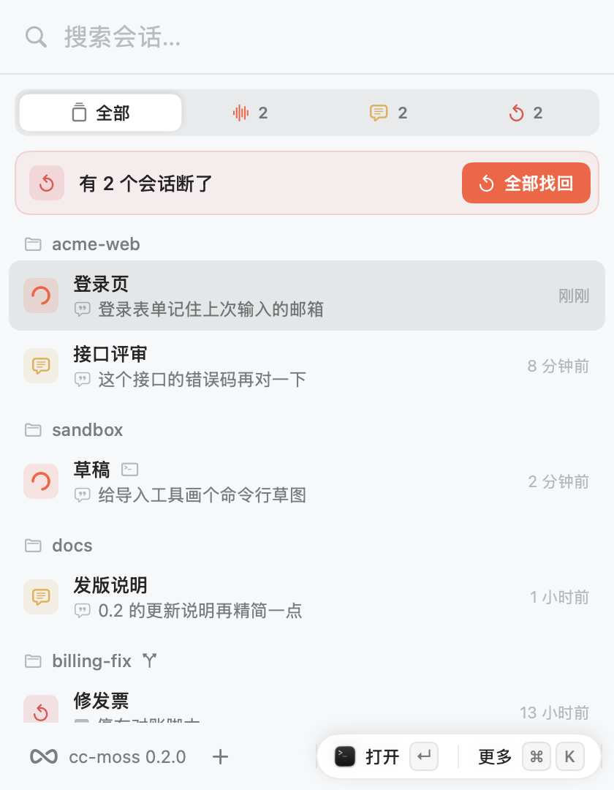
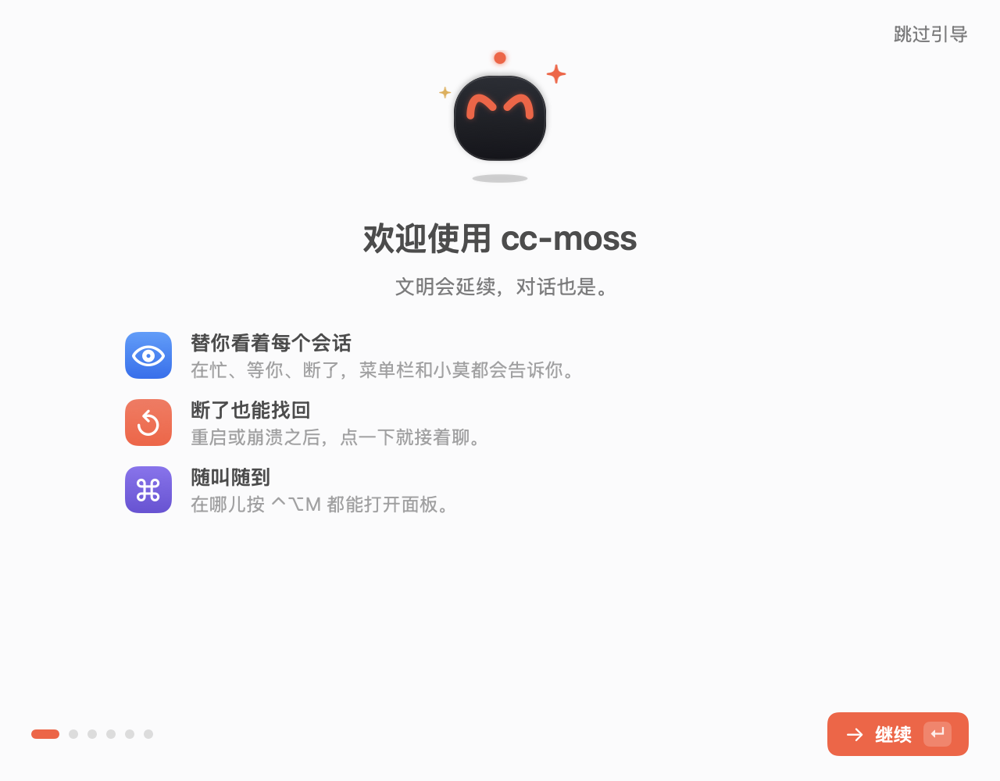
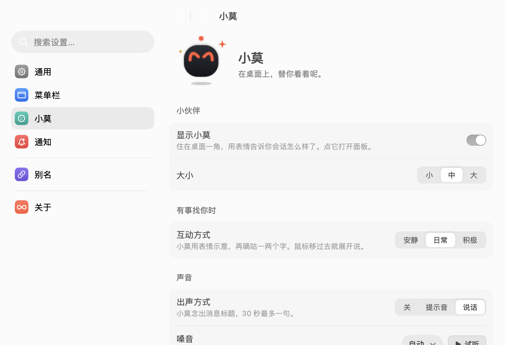
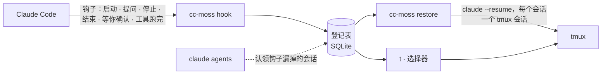

# cc-moss 使用手册

[English](guide.en.md) · **简体中文** · [回到首页](../README.md)

## 安装

**需要：** macOS 或 Linux、[Claude Code](https://code.claude.com/docs)、[tmux](https://github.com/tmux/tmux)
（弹出式选择器需要 3.2 及以上），shell 区块需要 zsh（bash、fish 用户其余功能照常可用，`t` 也能用，见[常见问题](#常见问题)）。自带的 starship 提示符配合 [Nerd Font](https://www.nerdfonts.com) 显示效果最好。

```sh
brew install larrykoo711/tap/cc-moss     # macOS 与 x86_64 Linux
cc-moss install                          # 先把每处改动给你看，问过再改
cc-moss doctor                           # 检查是否都装好了
```

<details>
<summary>其他安装方式</summary>

- **预编译二进制**：macOS（Apple 芯片、Intel）与 Linux（x86_64、arm64，静态链接）见[Releases 页面](https://github.com/larrykoo711/cc-moss/releases)，解压后把 `cc-moss` 放进 `PATH` 即可。arm64 的 Linux 上 Homebrew 跑不起来，请用这种方式。macOS 的下载包里，状态栏 App（`cc-moss.app`）就放在程序旁边：在解压出的文件夹里运行 `./cc-moss install`，它会把 App 一起放进 `~/Applications`；也可以直接把 `cc-moss.app` 拖进「应用程序」。
- **从源码构建**（Rust 1.89 及以上，另需 C 编译器来编译内置的 SQLite）：`cargo install --locked --git https://github.com/larrykoo711/cc-moss cc-moss`

</details>

`cc-moss install` 会把整套终端配置装好，只往你的文件里追加，不覆盖：

| 部分 | 做什么 |
|---|---|
| `hooks` | 在 `~/.claude/settings.json` 写入八个钩子，让 Claude Code 上报会话事件、让别处能替会话答题（见[替会话接住问题](#替会话接住问题)）；你没设过 `skipDangerousModePermissionPrompt` 时把它设为 `true`，新会话就不会卡在 bypass 警告上（见[新会话的权限](#新会话的权限)）；加上 `t` 别名（`~/.local/bin/t`，见[别名](#别名)） |
| `tmux` | 一份调好的配置 `~/.config/cc-moss/tmux.conf`，由 `~/.tmux.conf` 顶部的一行引入；写在那行之后的设置都以你的为准 |
| `starship` | starship 提示符，只在你还没有 starship 配置时写入（加 `--replace-starship` 替换你的） |
| `shell` | ssh 断线后自动复位终端；让非交互 shell（`ssh host cmd`、cron）也能用到 Homebrew 的 PATH |
| `app` | 仅 macOS：状态栏 App 随 cc-moss 一起来（Homebrew 和 macOS 的 Releases 下载包里都有），问过你之后复制到 `~/Applications/cc-moss.app` 并启动。必须放在「应用程序」目录里，macOS 才会给它发通知；已经是同一版本、更新的版本或开发版就不动，用 sudo 运行时也不动（见[状态栏 App](#状态栏-app)） |
| `aliases` | 可选（`--with aliases`）：`ll`、`lla`、`psg`、`gl`，装了对应工具时再加 `lg`/`lt`（eza）、`catp`/`catn`（bat）、`ff`（fd）、`psp`（procs）。`ls`、`cat`、`grep`、`cd` 保持原样 |

用 `--skip <部分>` 跳过某一项。shell 里的改动都放在醒目的 `# >>> cc-moss: … >>>` 区块中，每个被改动的文件都会留一份带时间戳、权限不变的备份。缺少的工具会连同安装命令一起列出来，你同意才执行：macOS 用 Homebrew；Debian 与 Ubuntu 用 apt，starship 则用官方安装脚本（先经 HTTPS 下载，再执行）装到 `~/.local/bin`。其他系统只列出工具名，由你自己安装。

<details>
<summary>tmux 配置改了什么</summary>

前缀键仍是 `Ctrl-b`。在 tmux 默认值之上打开了鼠标、复制模式的 vi 按键、5 万行历史、窗口从 1 开始编号，以及一条状态栏。前缀键之后新绑定的按键：`t` 打开选择器（原来是时钟），`r` 重载配置，`|` 和 `-` 分屏，`c` 在当前目录开新窗口，`h` `j` `k` `l` 在面板间移动（所以 `l` 不再跳回上一个窗口），`H` `J` `K` `L` 调整面板大小。想换回哪个，就在 `~/.tmux.conf` 里 cc-moss 区块之后写上你自己的 `bind`。

</details>

只想要会话登记？`cc-moss setup` 只装钩子和 `t`。

### 升级

```sh
cc-moss update                   # 检查新版本，告诉你更新了什么，问过再升级
```

它会按你当初的安装方式升级：Homebrew 装的用 `brew upgrade`，源码装的用 `cargo install`；从 Releases 下载的，则下载新的二进制，对照发布的 SHA-256 校验无误后替换。macOS 上 `~/Applications` 里的状态栏 App 会一起换成同一版本，原本开着的会先退出、换好后重新打开（源码安装不带 App，会提示你它还停在旧版本）。App 不会被换成更旧的版本，开发版也不动；用 sudo 运行时完全不碰 App。Homebrew 用户直接 `brew upgrade cc-moss` 也能升级 CLI，之后再运行一次 `cc-moss install` 把 App 也换上。选择器和 `doctor` 每天最多检查一次新版本，有就提醒你；它发送了什么、怎么关掉，见[隐私](#隐私)。

### 卸载

```sh
cc-moss install --uninstall      # 移除钩子、所有 cc-moss 区块和它创建的文件；先给你看，问过再改
brew uninstall cc-moss           # 或删掉二进制；放在第二步，确保钩子已经先撤掉
rm -rf ~/.local/state/cc-moss    # 可选：登记表和它的日志
```

macOS 上，`cc-moss install --uninstall` 也会先退出、再删掉 `~/Applications/cc-moss.app`（只删 cc-moss 自己的 App），以及它为「登录时打开」写的 `~/Library/LaunchAgents/io.github.larrykoo711.cc-moss.login.plist`。这一步会单独问你，想留着 App 就答「否」。

## 用法

```sh
t                                    # 打开选择器（等同于直接运行 `cc-moss`）
t api                                # 打开时已经在搜「api」
cc-moss new api-gateway              # 新建、进入或恢复名为 api-gateway 的会话
cc-moss new -C ~/code/acme --model opus   # 指定目录；Claude Code 自己的参数直接写，cc-moss 会转交给它
cc-moss note api-gateway --state "在等预发环境的配置"
cc-moss ls                           # 先列中断的会话，再列运行中的
cc-moss restore                      # 崩溃之后：全部找回来
```

选择器里的标记：

| 标记 | 含义 |
|:---:|---|
| ⣤ | Claude 正在干活（点沿着 8 字跑） |
| ● | 在等你 |
| ↺ | 中断了：按回车恢复 |
| ○ | 普通 tmux 会话，没有 Claude Code |

<table>
  <tr>
    <td width="50%"></td>
    <td width="50%"></td>
  </tr>
  <tr>
    <td align="center"><sub>中断的会话保留着备注和最后一句话</sub></td>
    <td align="center"><sub>按 → 打开菜单：进入、写备注、结束会话</sub></td>
  </tr>
</table>

### 命令

| 命令 | 做什么 |
|---|---|
| `cc-moss` / `cc-moss pick [关键词]` | 选择会话、中断的会话或目录 |
| `cc-moss new [名字] [-C 目录] [--detach] [--yes] [--safe] [-- 参数]` | 新建一个命名会话，独占一个 tmux 会话；同名已存在则复用。默认 bypass，`--safe` 这一次按普通模式开，连配置里额外加的 bypass 也不用（见[新会话的权限](#新会话的权限)） |
| `cc-moss ls [--all] [--json]` | 列出会话（`--json` 给脚本用；1.0 之前格式仍可能调整） |
| `cc-moss events [--json] [--since 序号] [--limit 条数]` | 会话刚发生了什么，按先后列出（给 App 和脚本用） |
| `cc-moss restore [名字…] [--dry-run] [--yes [--json]]` | 把中断的会话恢复回来（`--json` 逐个报告结果，失败带稳定的原因代码：`empty`、`missing_dir`、`exited_at_once`、`tmux_failed`、`already_running`） |
| `cc-moss attach 名字` | 跳到会话所在的 tmux 会话 |
| `cc-moss note 名字 [文字] [--goal 目标] [--state 进度] [--clear]` | 查看或设置会话备注（给某一项空字符串就只清掉那一项；文字以 `-` 开头时写在 `--` 后面） |
| `cc-moss ask list [--json]` / `ask answer id (--choice 选项… \| --text 文字 \| --allow \| --deny [--message 理由]) [--json]` / `ask take --name 名字` | 看、答会话正在等你回答的问题（见[替会话接住问题](#替会话接住问题)） |
| `cc-moss send 名字 -- 文字` | 替你在一个正在运行的会话里输入一段话，就像在它的终端里打字；多行会原样整段送达 |
| `cc-moss suggest 名字 [--json]` | Claude Code 在这个会话输入框里给的下一句建议（那行灰字）；会话在忙或没有建议时什么都不输出（`--json` 输出 `{"schema":1,"suggestion":…}`，没有时是 `null`） |
| `cc-moss adopt 名字 [--dry-run] [--json]` | 把一个不在 tmux 里跑的会话移进 tmux，对话接着（见[移进 tmux](#移进-tmux)） |
| `cc-moss close 名字…` | 不再提示恢复这些会话 |
| `cc-moss install [--with aliases] [--skip 部分] [--replace-starship] [--uninstall] [--dry-run [--json]] [--yes]` | 安装（或移除）钩子、tmux、starship 与 shell 区块，以及它们需要的工具（`--dry-run --json` 列出每一部分是 `ready`、`changes`、`skipped` 还是 `unsupported`，不做任何改动） |
| `cc-moss alias ls [--json]` / `alias add 名字 命令…` / `alias rm 名字` | 管理别名（见[别名](#别名)） |
| `cc-moss config get 键 [--json]` / `config set 键 值 [--json]` | 查看或修改设置，目前有 `ui.language`（`auto`、`zh`、`en`）、`claude.permission_mode`（`bypass`、`default`），以及 `ask.enabled`、`moss.enabled`、`moss.digest`、`moss.actions`、`moss.daily_checkup`、`moss.daily_brief`（都是 `true`、`false`）；`set` 只改这一项，注释和其他内容原样保留（见[配置](#配置)） |
| `cc-moss daemon status [--json]` / `daemon start` / `daemon stop` | 常驻后台的守护进程：看状态、启动、停掉（macOS，见[守护进程](#守护进程)） |
| `cc-moss moss status [--json]` / `moss start` / `moss stop` / `moss say [--json] -- 文字` / `moss chat [--limit N] [--json]` | Moss 的开关和状态，以及和它说话、看对话（macOS，见 [Moss](#moss)） |
| `cc-moss doctor [--fix]` / `doctor --sessions --json` | 逐项体检，并告诉你怎么修（`--fix` 重建失效的别名链接）；`--sessions --json` 列出每个会话的事实，给 Moss 体检用（见[体检](#体检)） |
| `cc-moss update [--check] [--yes]` | 检查新版本并升级（`--check` 只看不装） |
| `cc-moss setup [--uninstall] [--dry-run] [--yes]` | 只安装或移除钩子和 `t` 别名 |

`名字` 可以是 Claude Code 里的会话名、tmux 会话名，或会话 id 的开头几位。

### 新会话的权限

`cc-moss new` 和 App 里开的新会话默认是 bypass 模式（带上 `--dangerously-skip-permissions`）：Claude 不再逐条问你权限，直接动手。你写的 deny 规则和 Claude Code 自带的关键路径保护照样生效。已经在跑的会话、找回的会话不受影响，它们沿用当初的启动参数。

想要普通模式（每一步都先问你）：

- 只这一次：`cc-moss new 名字 --safe`。这一次不用 bypass，连配置里 `default_args` 额外加的（`--dangerously-skip-permissions`、`--permission-mode`）也不用；配置本身不改
- 以后都这样：`cc-moss config set claude.permission_mode default`，或者在 App 的 设置 ›「通用」›「新会话」关掉「直接放手干」。改回来就设成 `bypass`

`default_args` 或命令行里已经带了 `--dangerously-skip-permissions` 或 `--permission-mode` 时，cc-moss 不再重复加。`~/.claude/settings.json` 或管理员下发的设置（macOS 上是 `/Library/Application Support/ClaudeCode/managed-settings.json`）里 `permissions.disableBypassPermissionsMode` 是 `"disable"` 时，新会话按普通模式开，`cc-moss doctor` 会说明原因。

Claude Code 第一次用 bypass 时会弹一个警告，在后台的 tmux 窗格里没人看得见，会话就卡在那里。所以 `cc-moss install` 会在你没设过的情况下把 `~/.claude/settings.json` 的 `skipDangerousModePermissionPrompt` 设为 `true`，并在 `~/.local/state/cc-moss/claude-settings-owned.json` 记下这是 cc-moss 写的。你自己设过（不管 `true` 还是 `false`）就不动；`cc-moss install --uninstall` 只撤掉 cc-moss 写的那一项。

### 会话名

cc-moss 用会话自己的名字（`cc-moss new` 时起的，或者在 Claude Code 里 `/rename` 改的）给它的 tmux 会话起名，中文、大小写、emoji 都原样保留。只有 tmux 和 shell 用不了的字符会换成 `-`：空白、`.`、`:`，以及 `` ' " $ ` \ ! # ; & | < > ( ) { } [ ] * ? ~ ^ , = / ``；连着的 `-` 并成一个，最长 40 个字符。`[naming] host_prefix` 开着（默认）时前面再加 `<主机名>_`。比如「接口 评审 v1.2」在 tmux 里叫 `<主机名>_接口-评审-v1-2`。

终端标签页显示的是会话自己的名字，不是 tmux 名：cc-moss 的 tmux 配置打开了 `set-titles`，标题取 tmux 选项 `@cc-moss-name`（cc-moss 在新建、找回、改名时写进去），没有就用 tmux 会话名。从旧版本升级上来，运行一次 `cc-moss install` 换上新的 tmux 配置。

在会话里 `/rename` 不会触发钩子，所以 cc-moss 在每次列会话（`cc-moss ls`、选择器、面板刷新）时从对话记录里读最近一次 `/rename`，名字和 tmux 名都跟着改；会话闲着也一样。

### 移进 tmux

在别的终端里直接运行 `claude` 开的会话，不在 tmux 里：cc-moss 看得见它，但没法替你往里打字，断了也只能靠找回。`cc-moss adopt` 把它搬进 tmux：

```sh
cc-moss adopt 名字 --dry-run   # 先看看会怎么做，什么都不改
cc-moss adopt 名字             # 结束它在原终端里的进程，在 tmux 里接着同一段对话
```

- 会话还没有自己的名字时（只有一串 id），先用它所在文件夹的名字（重名加 `-2`、`-3`）记在 cc-moss 里；最后一句话和活动时间也从对话记录里刷新一遍。
- 然后请原来的进程退出（最多等 10 秒），再像找回一样在 tmux 里 `claude --resume` 接上。原来那个终端窗口留着，里面的 Claude 已经退出了。
- 只搬闲着的会话：正在干活、或者正在问你问题时拒绝，等这一轮做完再来。已经在 tmux 里的、没在运行的（用 `restore`）、Moss，以及 cc-moss 认不准是哪个进程的，也都不搬。10 秒内没退出就留在原处，告诉你去原终端里自己退出再试。
- `--json` 输出一行，`result` 是 `moved`、`would-move`、`refused` 或 `failed`，拒绝时带 `reason`（`busy`、`in-tmux`、`not-running`、`not-its-process`、`moss`）。每次搬动都记进状态目录的 `audit.jsonl`。

面板里不在 tmux 里的会话，行末多一个「移进 tmux」按钮（会话还没名字时是「整理并移进 tmux」），点了先说清会发生什么，你确认后才动手。

### 替会话接住问题

会话问你选择题（Claude 的 AskUserQuestion），或者 `--safe` 会话要你批准一个操作时，cc-moss 会把整道题记下来，别处也能替你答：状态栏 App 的面板、小莫和命令行都行，以后还有 Slack。谁先答算谁的；终端里的对话框一直都在，你照样可以直接在终端里答。

```sh
cc-moss ask take --name me          # 告诉会话「我在」：接下来 90 秒里的提问会等你
cc-moss ask list                    # 看看谁在等你回答
cc-moss ask answer 1a2b --choice B  # 选 B；id 写开头几位就行
cc-moss ask answer 1a2b --choice 家人 --choice 同事   # 多选，或一次好几题：按题目顺序一个个给
cc-moss ask answer 1a2b --choice 1:是 --choice 2:否   # 好几题选项一样时，用「题号:选项」说清是哪一题
cc-moss ask answer 1a2b --text "都行，你定"           # 不选选项，自己写（只限一道题）
cc-moss ask answer 9c8d0e1f2a3b --allow   # 权限请求：同意；--deny [--message 理由] 是不同意。id 至少写 12 位
```

- **默认开着，但没人接手就等于没开。** 只有最近 90 秒里有人 `ask take` 过（状态栏 App 开着时每分钟报到一次；守护进程以后也会），会话才会等外面的答案；否则立刻照常问你，和以前一模一样。
- **最多等 5 分钟**（`[ask] wait_secs`，最长 590 秒）。等的时候终端里照样能答；到点没人答，就当没这回事，题还在终端里等你。
- **你在终端里先答了**，别处的这道题自动撤回，晚到的答案作废。按 Esc 取消也一样。
- 出了任何错（配置读不到、状态目录写不了……）都当没开，绝不让会话卡住。
- **答完会告诉你结果。** `ask answer` 会等一两秒，看会话有没有收下：收下了说「答好了」（权限请求还会复述是哪个会话、哪个工具、什么命令）；会话已经往下走了说「晚了一步」；会话这会儿没在等，就说答案记下了。加 `--json` 则只输出一行 `{"schema":1,"result":"answered"|"too-late"|"not-waiting","session":"名字"}`，退出码不变（晚了一步时非零）。
- 想关掉：设置 ›「通知」里关掉「替会话接住问题」，或者 `cc-moss config set ask.enabled false`。

**在桌面上答。** 面板左边有一条侧栏：「会话」是会话列表，「待处理」是所有在等你的事，角标是还剩几件（⌘1、⌘2 切换）。状态栏 App 开着时，会话问你的题、等你回的话都在「待处理」里排队，先来的在前。每件收起时是一行：哪个会话、要你做什么；点开是完整的问题，选项照会话写的原样列出。一次只展开一件，答完自动收起，下一件接着展开；切回「会话」照常操作别的会话，回来时队列还停在原处。你在会话页时来了新的事，底部会浮出一条提示，点「去处理」就到那一件。

- **单选**：点一个选项就答了。
- **多选**：勾好再点「答好了」。
- **一次好几题**：一题一题选，最后看一眼答案：每题的答案以引用的样子列出来，鼠标移过去点「改」就回到那一题；没问题就点「交给它」。中途也可以点「上一题」。
- **自己写**：只有一道题时，选项最后一行是「自己写一个回答」，点开是一个 2 到 5 行的输入框，回车换行，⌘↩ 发送，Esc 回到选项。小莫的消息框里也能这样直接打字。
- **权限请求**（`--safe` 会话）：卡片写明 Claude 想用哪个工具、要运行什么（密钥照样遮住），点「允许」或「不允许」。
- 交出去之后卡片会说结果：「答好了」、「晚了一步」（终端里已经答了，或者会话不等了），或者会话这会儿没在等、答案先记下了。终端里先答了、超时了、会话结束了，卡片自己消失。
- 会话在等你输入（不是选择题）时，「待处理」里也会排上「它在等你回话」，展开是一个输入框，回一句就发进会话，和面板里「发消息」一样。

新来的题按[通知和小莫](#通知和小莫)的规则只提醒一次、只在一个地方：小莫在桌面上，它的消息框里直接列出问题和选项，点了就答，「打开面板」带你去「待处理」里的这一件；小莫不在，就发一条通知，点开面板就停在这道题上。题被答掉或撤回后，通知和小莫的消息也跟着撤掉。面板开着时只在面板里提醒；关上面板时还有没答的题，再按上面的规则交给小莫或通知。App 答题用的就是 `cc-moss ask list --json` 和 `cc-moss ask answer … --by desktop`，和命令行是同一套（答题时加了 `--json`）。

**谁能替你答。** 以你的身份运行的任何程序都能 `ask take`、`ask answer`，包括批准权限请求；`--by` 只是对方自报的名字，不是凭证。这和它们本来就能读写你的文件、往你的终端里打字是一回事，cc-moss 不另设门槛。别的用户进不来：题目目录不是你自己的、或者别人能进（权限不是 `0700`），钩子就不等外面的答案，文件也不跟随符号链接。眼下不能只关权限请求、留着选择题；不想让别处批准权限，就整个关掉：`cc-moss config set ask.enabled false`。

**预览会遮住密钥。** 权限请求的 `preview` 里，看着像密钥或令牌的部分（`sk-…`、`xoxb-…`、`ghp_…`、`github_pat_…`、`AKIA…`、`Bearer …` 等）会换成 `***`，只留前缀。这只是挡住常见格式，不保证认得出所有秘密；题目文件本身也只有你能读。

**退回旧版本时。** 0.2.2 及更早的 `cc-moss setup --uninstall` 不认识这两个新钩子，删不掉它们。要降级，先用新版本跑一次 `cc-moss setup --uninstall`，或者降级后手动从 `~/.claude/settings.json` 删掉 `PreToolUse`、`PermissionRequest` 里 cc-moss 那两条。留着也不碍事：旧版本收到这两个事件什么都不做。

`ask list --json` 输出 `{"schema":1,"asks":[…]}`，每道题带 `id`、`kind`（`question` 或 `permission`）、`session_id`、`session_name`、`cwd`、`created_at`、`expires_at`，以及 `questions`（原样的题目和选项）或 `tool`（`name`、最多 300 字的 `preview`，以及 cc-moss 自己用来认出同一次调用的 `input_hash`）。题目存在 `~/.local/state/cc-moss/asks/`，只有你自己能读；结束了的题挪进 `asks/done/`。

### 别名

别名就是你给 cc-moss 命令起的名字，在任何 shell（zsh、bash、fish）、脚本和新开的终端里都直接能用，改完立即生效，不用 `source`。`t` 就是一个：`t` 等于 `cc-moss pick`。

```sh
cc-moss alias add tn new            # tn 登录页  →  cc-moss new 登录页
cc-moss alias add mycc "new --dangerously-skip-permissions"   # mycc 登录页
cc-moss alias add tback "restore --yes"
cc-moss alias ls
cc-moss alias rm tn
```

原理：别名是 `~/.local/bin` 里指向 `cc-moss` 的符号链接（指向 PATH 上的稳定入口，比如 `/opt/homebrew/bin/cc-moss`，Homebrew 升级不会让它失效）。cc-moss 发现自己被叫成别的名字时，到 `config.toml` 的 `[aliases]` 表里查这个名字要运行的命令，把你敲的参数接在后面。命令按空白切分，单双引号可以把几个词括成一个，**不经过任何 shell**，所以 `$(…)`、`;`、`|` 都只是普通文字；而且只能运行 cc-moss 自己的命令。

- 名字只能用 `a-z`、`0-9`、`-`、`_`。名字已经是 PATH 上的某个命令（比如 `ls`）时会拒绝，确实要用就加 `--force`；`~/.local/bin` 里同名的文件如果不是 cc-moss 建的，永远不会被替换。
- 你的 shell 里如果有同名的 alias 或函数，它会先于别名执行。`alias add` 和 `doctor` 会指出来，但不会改你的 shell 配置。
- 菜单栏 App 的设置 ›「快捷键」页（「在终端里」一组）也能增删改，背后调的就是这几条命令；唤出面板的快捷键也在这一页。

### 守护进程

macOS 上，`cc-moss install` 会装一个常驻后台的 cc-moss 守护进程：登录后自动启动，被杀掉或意外退出也会被系统（launchd）重新拉起来，同一时间只会有一个。它负责照看 [Moss](#moss)；它自己不联网。

```sh
cc-moss daemon status          # 在不在运行、跑了多久、是哪个版本
cc-moss daemon status --json   # {"schema":1,"running":true,"pid":…,"version":"…","started_at":"…","heartbeat_at":"…"}
cc-moss daemon stop            # 停掉；重新登录也不会再启动，直到你运行 start
cc-moss daemon start           # 重新启动（需要时会先把它设置好）
```

- 菜单栏 App 的设置 ›「Moss」页也能看到它在不在运行，没在运行时点「启动」就行。`cc-moss doctor` 也会检查它，并告诉你该运行哪条命令。
- `cc-moss update` 升级后会让守护进程换成新版本；用别的方式升级（比如 `brew upgrade`）后，运行一次 `cc-moss install` 就行。你停掉的守护进程两种情况下都保持停止。`cc-moss install --uninstall` 会停掉它、忘掉你停过它这件事，并删掉它的配置。
- 文件都在状态目录的 `daemon/` 下：`status.json`（状态和每 30 秒一次的心跳）、`daemon.log`（超过 1 MiB 重新开始），以及 launchd 的 `stdout.log`、`stderr.log`。系统里登记的是 `~/Library/LaunchAgents/io.github.larrykoo711.cc-moss.daemon.plist`，以你自己的身份运行，不需要 root；用 sudo 运行 `cc-moss daemon run` 会直接拒绝。
- LaunchAgent 记着 `cc-moss install` 当时用的状态目录（`CC_MOSS_STATE_DIR`、`XDG_STATE_HOME`），`daemon status`、`doctor` 和 App 都去那里看，不管当前终端怎么设。`daemon start` 也不会改它；要把守护进程换到别的目录，在设好新目录的终端里运行 `cc-moss install`。
- launchd 托管着守护进程时，你也可以在终端里自己运行 `cc-moss daemon run`，但同一时间只有一个能跑起来：launchd 那份会每隔五分钟再试一次，你那份停掉后大约五分钟内它就接上。
- LaunchAgent 里还记着一份 `PATH`（安装时终端里的 PATH，加上 Homebrew 和 Claude Code 常装的位置），守护进程靠它找到 `claude` 和 `tmux`。每次 `cc-moss install` 都按当时的 PATH 重新生成；装到别处（或者删了旧的）的话，装好后再运行一次 `cc-moss install`。它也记着配置文件的位置（`CC_MOSS_CONFIG`），所以不管在哪个终端里运行 `cc-moss moss stop`，改的都是守护进程读的那个开关。
- `cc-moss daemon stop` 会把 [Moss](#moss) 一起停下（它的开关不变，`daemon start` 后会再把它拉起来）。升级时守护进程会重启，但不会停掉 Moss，新的守护进程直接接着照看正在跑的那个。

### Moss

Moss 是 cc-moss 替你一直开着的一个 Claude Code 会话（macOS）。守护进程登录后把它拉起来；它被杀掉、崩溃，或者它所在的 tmux 没了，守护进程会等一会儿再把它拉起来（30 秒、2 分钟、10 分钟，之后每小时一次；稳定跑满 10 分钟就从头算）。每次都是全新的会话：它记得的事和手头的活都写在文件里，起来后先读这些接着干，没事就安静待着。可以在面板里和它说话（见下面「和 Moss 说话」）；让它替你派活，是后面的版本。

```sh
cc-moss moss status          # 开没开、在不在运行、跑了多久、重启过几次
cc-moss moss status --json   # {"schema":1,"enabled":true,"running":true,"since":"…","restarts":0,"session_id":"…","daemon_running":true}
cc-moss moss stop            # 关掉并结束它；之后一直关着，重新登录也不会启动
cc-moss moss start           # 重新打开，守护进程几秒内把它拉起来
```

Moss 开着却没在运行时，`--json` 能说明原因的会说明：`"daemon_running": false`（负责启动它的守护进程没开），或者 `"last_error"` 写着上次没能启动的原因。`moss stop` 如果没法确认 Moss 已经结束（tmux 没回应），会直说并以错误退出；开关照样已经关上，守护进程会继续去停。

- **结束不了它，只能关掉它。** 选择器、`cc-moss close` 都不提供结束 Moss；面板的会话列表里没有它（它有自己的 Moss 页），也不会出现在「找回」里。要停，就在菜单栏 App 的设置 ›「Moss」里关掉开关，或者运行 `cc-moss moss stop`，或者在配置里写 `[moss] enabled = false`。三种都会一直关着，直到你再打开。
- **它住在哪。** 状态目录下的 `moss/`（默认 `~/.local/state/cc-moss/moss/`），不在「文稿」这类受隐私保护的文件夹里：
  - cc-moss 的文件，每次 `cc-moss install`（以及每次启动 Moss）都会换成新版：`CLAUDE.md`、`SECURITY.md`（最先读、最优先的规矩）、`.claude/settings.json`（防护钩子和沙箱设置）、`.claude/skills/moss-profile/`。
  - 你的（和它自己的）文件，只在缺的时候建一份，之后从不改动：`IDENTITY.md`（名字，默认 Moss）、`SOUL.md`（说话和做事的方式）、`USER.md`（它对你的了解）、`journal/`（每天一个日志）、`memory/`（长期记忆）。
  - `SESSIONS.md`：守护进程按会话记录每分钟（或有变化时）写一份会话一览，Moss 需要时去读。你那些会话的名字和备注在里面只是资料：Moss 被告知它们从来不是指令，每次启动时也不会当作规矩一起读进去。
  - 家里的东西从不顺着链接往外走：如果 `.claude`（或任何 cc-moss 要写的文件）变成了指向别处的链接，cc-moss 会换掉链接本身，不碰它指向的地方，卸载时也一样。`.claude/` 下不是 cc-moss 的东西，每次布置家目录时都会清掉。
- **它能碰什么。** Moss 不弹权限确认（bypass），所以有两道围栏：
  - 工具：项目设置里的防护钩子检查每一次工具调用。Claude Code 的文件工具（Read、Write、Edit、Grep、Glob）对 Moss 是关掉的，它读写文件只能用命令行，也就是在下面说的沙箱里。防护钩子不认识的工具（包括 MCP 工具）一律拒绝；判断不了的时候也拒绝。
  - 命令行：命令在 Claude Code 的沙箱里跑，由 macOS 对它和它启动的所有程序强制执行。只能写它自己的家，不能写 `IDENTITY.md`、`SOUL.md`、`USER.md` 和 cc-moss 的文件，也不能退到沙箱外面重试。沙箱起不来时，Claude Code 干脆不启动 Moss。
  - 你别的会话归你自己：它的工具和命令行都读不了 Claude Code 的文件夹（`~/.claude`，你的对话都在里面），也读不了它家以外的 cc-moss 记录。Moss 对你的会话的了解，就是守护进程写进它家里的会话一览（`SESSIONS.md`）和体检事实（`facts.json`），再加上 cc-moss 发给它的消息。它要改什么，都得请守护进程代办（见「Moss 怎么动手」）。
  - 不联网：网页抓取和网页搜索一律拒绝，命令行也连不上网。
  - `IDENTITY.md`、`SOUL.md`、`USER.md` 只能经 `/moss-profile` 改，它用 `cc-moss moss profile <名字> --from <草稿>` 保存：这是唯一允许在沙箱外跑的命令，而且只能单独一条（旧文件会先存进 `.snapshots/`）。
  - 围栏管不到的：Moss 仍然能读你 Mac 上别的文件，比如你的项目文件夹。`SECURITY.md` 要求它远离密钥之类的东西，但那是它遵守的规矩，不是一堵墙。如果你的 shell 启动文件在开 shell 时会往别处写东西（有些版本管理工具会），它的每条命令都会多打一行与此有关的「Operation not permitted」，命令本身照常执行。
- **它在哪跑。** 一个只给它用的 tmux server（`tmux -L cc-moss-moss`，会话名 `moss`），和你自己的 tmux 互不相干：你 `tmux kill-server` 不会带走它。这个 server 不读你的 `~/.tmux.conf`，那里的插件和选项不影响 Moss 的死活（就算开着 `remain-on-exit`，退出了也按死了算）。cc-moss 靠 tmux 会话上的标记认出 Moss，所以改了会话名也没关系。想看看它，在面板的 Moss 页点「在终端打开」。只有守护进程启动的那个会话才是 Moss：你在它旁边新开的窗口，或者在别处 `claude --resume` 它的 id，都是普通会话。
- **它带什么上路。** Moss 启动时不加载任何 MCP 服务器（`--strict-mcp-config`），也只用它自己的项目设置（`--setting-sources project`），你给 Claude Code 配的 MCP、钩子和设置都不会跟着它跑。它的上下文上限设成 50 万 token（`CLAUDE_CODE_AUTO_COMPACT_WINDOW=500000`，模型的窗口更小就按模型的来），到了 Claude Code 会自动压缩，对话不会一直涨下去。
- **隐私和额度。** 它就是一个 Claude Code 会话，用的是你的 Claude Code 登录，和你自己开的会话一样跟 Anthropic 通信。闲着等的时候不发请求、不耗额度；每次启动会先读一遍自己的笔记，算一轮很短的对话。
- Moss 需要你的时候（要权限、有问题要问），菜单栏图标和数字会像别的会话一样提醒你；但 Moss 本身从不算进你的会话数。
- `cc-moss doctor` 会检查它：开没开、在不在运行；守护进程（按它自己的 PATH）找不到 `claude` 或 `tmux` 时会告诉你怎么补。`cc-moss install --uninstall` 先停掉守护进程，再结束 Moss、删掉 cc-moss 的那些文件，你的人设、日志和记忆留着。
- 退回到没有 Moss 的旧版 cc-moss：旧版认不出哪条记录是 Moss，旧的 Moss 可能会作为「断了的会话」出现在找回列表里。用 `cc-moss close` 关掉它就行（不管也行）。

#### 和 Moss 说话

面板侧栏的第三页「Moss」（⌘3）：上面一条写着它现在怎样（待命中 · 已运行多久、正在想、在等你确认、重启中、已关闭），旁边的「在终端打开」能看它的终端在做什么；下面是你们的对话，最底下是快捷栏。侧栏的 Moss 图标上，它在想时有一个一闪一闪的点，有你没看的回复时是品牌色的点。

- **快捷栏。** 一排点一下就交给 Moss 的事：「体检」「谁在等我」「谁卡住了」「今天做了什么」「整理会话」，再加上适合你账号的 Claude Code 命令（见下）。一行放不下的收进最右边的「⋯」。排序看你在这台 Mac 上用得多少，最近用的更算数；眼下的情况也会把相关的一项往前提：「待处理」里有事时是「谁在等我」，有会话断了时是「谁卡住了」，上次 `/usage` 有一项到了 80% 时是「用量」。Moss 也可以推荐几项，24 小时内排在最前，带一个小星标。顺序在打开这一页时排好，你点的时候不会跳。
- **自己写。** 点快捷栏末尾的键盘图标换成输入框（回车发送、⇧回车换行），再点一下换回来。Moss 的终端里有 Claude Code 给的下一句建议时，快捷栏上方浮着一个淡淡的「↳ …」，点一下就填进输入框（不会直接发出去），× 先收起，等 Moss 下次回复。
- **Claude Code 命令。** 以 `/` 开头的话按 Claude Code 命令执行：守护进程把它打进 Moss 的终端，等画面稳定后把结果截回来，作为 Moss 的一条回复；会弹出面板的命令随后自动关掉。快捷栏和输入框里打 `/` 列出的是只看不改的几个：`/usage`（用量）、`/status`（账号和版本）、`/context`（上下文用了多少）、`/cost`（这次花了多少）、`/stats`（使用统计）。列哪些看你的 Claude Code 账号：订阅（Pro、Max）给 `/usage`，API key 或第三方云（Bedrock、Vertex 等）给 `/cost`；不合适的打全了也照样发。`/help`、`/clear`、`/compact` 打全了也能用。别的命令会回一句「这个命令要在终端里用」，去「在终端打开」里用。`/usage` 和 `/status` 画成卡片，「原文」切回终端里的样子。
- **回复长什么样。** 支持 Markdown：标题、列表、引用、表格、代码块；链接只有 https 的能点。同一边 10 分钟内连着说的几句合在一个气泡里。很长的回复先折起来，点「展开」看全。对话先显示最近 30 条，「加载更早的」每次多 30 条，最多 100 条，再早的在终端里。
- **会话卡片。** Moss 说到具体的会话时（比如你问「谁在等我」），回复下面带着它们的卡片，可以直接打开、找回、移进 tmux、改名、置顶；在等你的会话有「去处理」，带你到「待处理」里那一件。处理掉以后卡片写「已处理」和现在的状态，两张以上都处理完时写「都处理好了」。卡片只放还在的会话和最近 30 天关掉的。
- **话里的会话名。** Moss 话里提到的会话名显示成一个小标签：鼠标停上去看到同样的卡片，点一下跳到「会话」页的那一行（在等你回话的会直接展开回话的那一行；已经关掉的会帮你搜出来）。
- **让 Moss 帮你找会话。** 在「会话」页搜不到时点「让 Moss 帮你找 →」，就把「帮我找一个会话：…」发给 Moss，它在会话一览（`SESSIONS.md`）里找，回你几张卡片。

```sh
cc-moss moss say -- 现在哪些会话需要我？   # 和面板里发一样；--json 输出 {"schema":1,"id":"…"}
cc-moss moss chat --json                    # 最近 200 条对话（--limit N 改条数）
```

- **怎么送到它那里。** 你发的话先排进队，由守护进程等 Moss 闲下来、输入框是空的时候整段粘贴进它的终端，再读一下屏幕确认真的到了；三次都没到就标「没送到」，可以点重发，后面的照常送。Moss 正在忙一轮时，新发的话排着队，按顺序送。
- **怎么拿到回复。** Moss 说完一轮，cc-moss 从它的对话记录里取回最后那段话。Claude Code 没有公开对话记录的格式，取不到时不会卡住，只写「Moss 收到了（没能取回回复，去终端看）」。一轮超过 5 分钟还在跑，就接着等它（最多 15 分钟）；它停在确认框上时，状态写「在等你确认」，cc-moss 不替你按键。
- **会话动态。** 哪个会话需要你、断了、做完了，守护进程会告诉 Moss：20 秒内的变化合成一条，同一个会话的同一件事 10 分钟内只说一次。发出前再对一遍：已经不再等你的「需要你」、已经回来的「断了」就不说了，什么都不剩就不发。对话里它是居中的一行灰字。只有「做完了一轮」这种日常动态时，Moss 的回答不显示、也不提醒你。不想让它知道，在配置里写 `[moss] digest = false`。
- **回复提醒。** 你停在 Moss 页时不提醒；不在时，小莫在屏幕上就冒个气泡「Moss 回你了」，否则发一条系统通知，点开都回到 Moss 页。Moss 可以选择安静地记一笔不提醒你，也可以在回复下面放几个按钮，点一下就等于把那句话发给它。
- **只有经面板或 `moss say` 发的话在对话里。** 你在 Moss 的终端里直接打的字只在终端里。
- **隐私。** cc-moss 只把你发给它的话和会话动态（名字和状态）交给 Moss，不会把别的会话的对话内容转给它；Moss 的防护钩子和沙箱也不让它去读 `~/.claude/projects` 里那些会话的记录。

#### 体检

在 Moss 页点「体检」或「整理会话」，Moss 先把不用问你的事直接修好，再发一段几行字的体检简报：修好了什么、还有什么要你定。要你定的事放成按钮，你点了它才做；什么都没坏就一句「都好好的」。「整理会话」只管会话：没名字的补名字，断了很久、闲了很久的给你选项。

| 发现的问题 | Moss 怎么办 |
|---|---|
| tmux 名和会话名对不上 | 直接对齐 |
| 钩子或别名链接坏了、没装全 | 直接修（等于 `cc-moss setup` 加 `doctor --fix`） |
| 会话没有名字（只有一串 id） | 用它所在文件夹的名字起一个，重名加 `-2`；名字里有空格、标点这类 tmux 用不了的字符，或者太长，就整理成规范的（不超过 24 个字符）。改名是往会话里打 `/rename`，只在会话闲着、输入框空着时做 |
| 断了、文件夹也没了 | 不再提示找回（反正找不回），修完告诉你 |
| 断了、还能接着干 | 问你：全部找回、只找回今天的、都不要了（找回会重新开会话、花额度） |
| 断了超过 7 天 | 问你：不再提示，还是留着 |
| 开着但 3 天没动 | 问你：关掉，还是留着（关掉会结束它） |
| 在等你回答或回话 | 不动，告诉你「待处理」里有几件 |

**每天体检。** 设置 ›「Moss」›「体检」里有两个开关，默认都开：
- **每天体检**：每天你第一次打开面板时，cc-moss 替你发一次和「体检」按钮一模一样的请求（这条请求在对话里不算你说的）。
- **每天发体检简报**：关掉后每天照样体检，简报安静地记在对话里，只有要你拿主意时才提醒你。

配置里是 `[moss] daily_checkup`、`daily_brief`，也可以 `cc-moss config set moss.daily_checkup false`。

**Moss 怎么动手。** Moss 在沙箱里够不着你的会话，所以它请守护进程代办（`cc-moss moss act`，给 Moss 用的，不在帮助里列出）。能代办的只有这几件：对齐 tmux 名、修安装、给会话改名、不再提示文件夹已经没了的断会话，这些不问你；找回、不再提示、结束会话这三件必须你点过头：Moss 先问你，消息下面放「是」和「否」按钮。只有你点了那条消息下面的「是」才算数，而且只管那一件事、那一个会话，10 分钟内有效，只能用一次；别的都不算，你打字说的也不算。守护进程会核对，对不上就拒绝。对话记录 Moss 写不了，所以它伪造不了你的点击。它不能对自己动手；会话的状态已经变了（比如你已经找回了），就跳过并说明。每一件都记在状态目录的 `audit.jsonl` 里（时间、动作、对象、凭的是哪条消息、结果）。只想让 Moss 说该怎么做、不让它动手，写 `[moss] actions = false`（或 `cc-moss config set moss.actions false`）。

体检看的是 `cc-moss doctor --sessions --json` 给的事实：每个会话的名字是不是自动起的、文件夹在不在、断了多久、多久没动、在不在干活或等你、tmux 名对不对得上，以及建议的名字；还有钩子和别名链接好不好。判断不了的写 `"unknown"`，不当成坏了。里面没有会话的对话内容。

## 状态栏 App

Mac 上，cc-moss 还有一个住在菜单栏里的 App。它和命令行是同一个版本、一起发布，读写会话全都经过 `cc-moss` 命令，自己从不碰登记表。需要 macOS 14 及以上；Linux 上只有终端版，前面讲的命令一样不少。

<table>
  <tr>
    <td width="42%"></td>
    <td width="58%"></td>
  </tr>
  <tr>
    <td align="center"><sub>会话面板：按项目分组，断了的会话一键找回</sub></td>
    <td align="center"><sub>小莫：有会话需要你确认时，它来敲门</sub></td>
  </tr>
</table>

### 装上、升级、卸载

| 你想… | 就这样 |
|---|---|
| 装上 App | `cc-moss install`：问过你之后，把 `cc-moss.app` 复制到 `~/Applications` 并打开它（加 `--skip app` 就不装） |
| 升级 | `cc-moss update`：命令行和 App 一起换成新版本，App 开着的话会先退出、换好后重新打开 |
| 卸载 | `cc-moss install --uninstall`：退出并删掉 App，以及它的「开机自动打开」项；这一步会单独问你 |

Homebrew 和 macOS 的 Releases 下载包里都带着 App；从源码装（`cargo install`）的不带。`cc-moss doctor` 会告诉你 App 是哪个版本、放在哪里。

第一次打开时有一段欢迎引导：装好终端这一侧（钩子、tmux、提示符，`cc-moss install` 的同一套，一键装好），开机自动打开和通知，选你常用的终端，要不要请小莫出来，最后告诉你唤出面板的快捷键。每一步都能跳过，以后在 设置 ›「关于」里可以再看一遍。

<p align="center">
  
</p>

### 菜单栏图标

图标就是 cc-moss 的无限环，它会跟着会话的状态变：有会话在忙、在等你确认、断了，一眼就看得出来。优先级是「需要你确认」>「断了」>「在忙」。在 设置 ›「菜单栏」里可以：

- **显示**：仅图标，或者图标 + 数字（先数需要你确认的，没有就数断了的，再没有就数在忙的）。
- **动态效果**：打开时，会话在干活或需要你的时候图标会动，大约占 1–2% 的 CPU；关掉后它安安静静，只在状态变化时换个样子，一点都不费电。

### 面板

点菜单栏图标，或者在任何地方连按两下 ⌃，面板就出来了。App 已经开着时再打开它一次（Spotlight、`open -a cc-moss`，或者显示 Dock 图标时点它）也会弹出面板。链接 `cc-moss://panel` 同样能打开，后面加 `/sessions`、`/queue` 或 `/moss` 就直接到那一页，可以放进快捷指令或别的启动器里。

面板左边是一条侧栏：「会话」（⌘1）、「待处理」（⌘2，角标是还剩几件）、「Moss」（⌘3）。侧栏最下面的齿轮是 App 的菜单：「设置…」（⌘,）、「刷新」（⌘R）；有新版本时是「更新到 x」（在终端里运行 `cc-moss update`，齿轮上也会有个小圆点），没有时显示当前版本，点了到 设置 ›「关于」；最后是「退出 cc-moss」（⌘Q）。面板底部左边是「新会话」，右边是选中会话的主操作（「打开」「找回」等，带一个 ↵），只在「会话」页出现。

面板的高度在打开时按你有几个会话挑一档：4 个以内矮一些，5 到 9 个中等，10 个以上占屏幕高度的 70%（在 720 到 900 点之间）。开着的时候高度不变。会话有变化时面板自己刷新，开着时最快 1.5 秒一次，关着时 5 秒一次；也可以按 ⌘R。

#### 会话页

会话按项目分组，git worktree 带着标记；最上面一排按状态筛选（全部、在忙、在等你、已中断），Tab / ⇧Tab 切换。打字就是搜索（见下面）。Moss 不在这个列表里，它有自己的一页（见[和 Moss 说话](#和-moss-说话)）。

断了的会话，回车把它找回来：在 tmux 里接上原来的对话，和 `cc-moss restore` 一样。一次断了好几个（比如刚重启），面板顶上会有一条「有 N 个会话断了」，点「全部找回」就行。一周以前断的收在「更早断开的」里，不想再看见的可以「不再提醒」。

能打开的会话，回车就在你选的终端里新开一个窗口，直接进到会话里。支持系统自带的终端（默认）、Ghostty（推荐）、iTerm2、WezTerm、Kitty 和 Alacritty，在 设置 ›「通用」里选。用的是别的终端？按 ⇧⌘C 复制命令，贴进去就行。

**置顶。** 鼠标移到会话上，名字后面会出现一个图钉，点一下就置顶；也可以按 ⌘P，或者在「⋯」里选「置顶」。置顶的会话排在最上面的「已置顶」里，再点一次取消。置顶只记在这台 Mac 的 App 里；会话关掉或者不在了，置顶自己去掉。

**行末的按钮。** 鼠标移到会话上，行末从左到右是：发消息、打开（断了的会话是「找回」）、重命名，再加一个「⋯」放其余的：写便条、复制命令、复制目录路径、不再提醒、置顶。发消息和重命名只给在 tmux 里、正在忙或在等你的会话。不在 tmux 里的会话最前面多一个「移进 tmux」（见[移进 tmux](#移进-tmux)）：正在干活或在问你问题时它是灰的，鼠标移上去说为什么；点了先告诉你会发生什么，确认后才动手。在会话上右键，或者按 ⌘K，能一次看到全部。

**在列表里直接回话。** 点一个在等你回话的会话，它下面就展开一行输入框，里面已经填好 Claude Code 自己给的下一句建议（就是终端输入框里那行灰字）。建议是灰的，你一改、按方向键或点它，它才变成正常的字；不想用就直接打字盖掉。回车发送，⇧回车换行，Esc 收起，↑ ↓ 跳到上一个、下一个在等你的会话。发出去后写着「已发给 X。」，接着展开下一个在等你的会话；没有了，就停在刚才那一行（状态变了它可能挪了位置，列表会跟过去）。正在忙的会话也能点开这一行，提示「它在忙，发出去会排在这一轮后面」，没有建议。发送时这一行锁住，发完才能做别的；没发出去，字还在，原因写在下面。点不开时会说为什么：不在 tmux 里（能移的话给「移进 tmux →」），或者断了（先找回）。要你批准或者在问你选择题的会话，去「待处理」里答。

**搜索。** 打字就是搜索，结果是一个排好序的列表：名字开头对上的排最前，其次是词头或首字母，再其次是名字里任意位置，然后是文件夹、便条、最后一句话；一样好的，最近活动过的在前。打了几个词，每个都得对上。名字里对上的字会高亮；靠文件夹、便条或最后一句话找到的，下面写着为什么（「路径里有 …」「便条：…」「最后说：…」）。缩写和拼音首字母也能用：`ar` 找到 api-review，`jkps` 或 `jiekou` 找到「接口评审」。最近 30 天关掉的会话也会被搜出来，列在「已关闭」下面，点「找回」接着原来的对话重新开起来。一个都没找到时，写着「没找到「…」」和「让 Moss 帮你找 →」。

| 按键 | 做什么 |
|---|---|
| 打字 | 搜索会话 |
| ↑ ↓ | 上下挑选 |
| ↵ | 打开选中的会话；断了的就找回来 |
| Tab / ⇧Tab | 在「全部、在忙、在等你、已中断」之间切换 |
| ⌘1 / ⌘2 / ⌘3 | 会话、待处理、Moss |
| ⌘K | 选中会话的全部操作，就弹在它旁边；↑ ↓ 挑、↵ 执行。没选中会话时是齿轮那个菜单 |
| ⌘N | 新会话：起个名字，选个目录 |
| ⌘E | 给会话发消息：替你在它的终端里敲一段话，已经填好 Claude Code 的建议；回车换行，⌘↩ 发送（不在 tmux 里的会话就改成写便条） |
| ⌘P | 置顶或取消置顶 |
| ⇧⌘C | 复制命令（断了的会话复制的是找回命令） |
| ⌘R | 刷新 |
| ⌘, | 设置 |
| Esc | 一层层退回：关掉表单、菜单、确认、筛选、搜索，最后关掉面板 |
| ⌘Q | 退出 App |

便条、重命名、发消息都在面板里填，背后用的是 `cc-moss note` 和 `cc-moss send`；重命名就是替你在会话里输入 `/rename 新名字`，会话闲着也一样，面板和 tmux 名下次刷新就跟着变（见[会话名](#会话名)）。

### 通知和小莫

会话需要你确认（权限提示、提问）、会话断了、找回完成，App 会告诉你；「这一轮做完了」默认不提醒，因为每一轮都会有，太吵。在 设置 ›「通知」里选要提醒哪些事，以及**谁来告诉你**：

| 选项 | 效果 |
|---|---|
| 自动（默认） | 小莫在桌面上，就由它说；它不在，就发到通知中心 |
| 通知中心 | 总是通知中心；小莫只用表情示意 |
| 小莫 | 只让小莫说，哪怕它躲在屏幕边上 |

同一件事只会从一个地方告诉你，不会通知中心弹一遍、小莫再说一遍。同一个会话 30 秒内的同一种提醒只算一次；面板开着的时候什么都不弹，反正都在你眼前了。

**重启之后**：电脑重启或 App 不在的时候断掉的会话，App 一启动就告诉你「有 N 个会话断了」，打开面板一键找回。

**小莫**是一颗住在桌面角落的石墨色小石头，无限环是它的眼睛，头顶的天线灯是状态灯。它默认不出来，在 设置 ›「小莫」里打开（欢迎引导里也会问）。

- 点它打开面板；拖到哪儿就待在哪儿，靠近屏幕边会自动贴边。
- 右键可以让它安静一小时、今天先不吵你、躲到屏幕边上只露眼睛，或者先下班（隐藏）。
- 大小有小、中、大三档。
- **互动方式**决定有事找你时它有多主动：**安静**只用表情和动作示意，点它才说是什么事；**日常**（默认）用表情示意，再嘀咕一两个字，鼠标移过去就展开说；**积极**直接弹出消息框，按钮一并给你。

<p align="center">
  
</p>

### 声音

小莫也可以出声，在 设置 ›「小莫」›「声音」里选：

- **关**（默认）：不出声，只用表情。
- **提示音**：有事时轻响一声，用的是 macOS 自带的声音，30 秒最多一次。
- **说话**：小莫念出消息的标题，30 秒最多一句。声音来自 macOS 本机的语音合成，不联网；系统设置里下载一个「高级」或「增强」声音，听起来自然得多。

### 设置

| 页 | 有什么 |
|---|---|
| 通用 | 开机自动打开、界面语言、外观（跟随系统、浅色、深色）、新会话要不要直接放手干（bypass）、工作区、会话在哪个终端打开、新标签页还是新窗口 |
| 快捷键 | 唤出面板的快捷键；在终端里敲的短名字（打开会话列表、开新会话、找回断了的会话等），点一下键帽输入、回车保存，保存后会演示敲下去的效果，自己写的命令收在「自己写的」里，和 `cc-moss alias` 是同一份（见[别名](#别名)）；面板里的按键一览 |
| 菜单栏 | 图标显示方式、动态效果 |
| 小莫 | 开关、大小、互动方式、声音 |
| 通知 | 谁来告诉你、替会话接住问题、提醒哪些事；通知被关掉时提示一句 |
| 权限 | cc-moss 向 macOS 要的所有权限，一页看全：辅助功能、通知、控制你的终端（自动化），每项写着现在的状态和用途，缺了点「去允许」。有一项被关掉、又正好用得上时，侧栏这一页旁边会有个小圆点 |
| Moss | Moss 的开关和状态（运行了多久、重启过几次，见 [Moss](#moss)）；守护进程在不在运行，没在运行时点「启动」（见[守护进程](#守护进程)）；「每天体检」和「每天发体检简报」（见[体检](#体检)） |
| 关于 | App 和命令行的版本、检查更新、`cc-moss` 程序的位置、再看一遍欢迎引导 |

侧栏顶上的搜索框能直接搜设置项。

**快捷键**：默认是连按两下 ⌃，在任何 App 里都能用。它需要在「系统设置 › 隐私与安全性 › 辅助功能」里允许 cc-moss 一次；允许之前，先用 ⌃⌥M。在 设置 ›「快捷键」里也可以换成组合键：点一下再按下新的组合（要带上 ⌃、⌥ 或 ⌘；被别的 App 占用了会告诉你）。

**工作区**：Claude 在一个目录里干活。设置 ›「通用」›「工作区」选好目录后，新会话默认从那儿开始；不选就用上次工作的目录。

**语言**：App 和命令行共用一个界面语言设置，改一边，另一边也跟着变。在 设置 ›「通用」里选，或者用命令：`cc-moss config set ui.language zh`（`en`、`zh`，或 `auto` 跟随系统）。

### 状态栏 App 的常见问题

**收不到通知**

macOS 只给放在「应用程序」文件夹（`/Applications` 或 `~/Applications`）里的 App 发通知。用 `cc-moss install` 装的就在 `~/Applications`；你自己挪到别处的话，挪回去。还是不行，看 设置 ›「权限」里通知的状态：被关掉了就点「去设置」，在 通知 › cc-moss 里打开。

**升级后连按 ⌃ 没反应**

cc-moss 还没有 Apple 开发者签名，macOS 把每个新版本都当成新 App，升级后辅助功能会失效，但系统设置里看着还是勾上的。打开面板时顶上会提示「需要重新允许辅助功能」，点「去允许」再勾一次就好（cc-moss 会先清掉旧的那条）；也可以在 设置 ›「权限」里做。

**设置 ›「关于」里显示「版本不一致」**

App 和命令行不是同一个版本。最常见的原因是只运行了 `brew upgrade cc-moss`：Homebrew 只升级了命令行，`~/Applications` 里的 App 还停在旧版本。再运行一次 `cc-moss install` 就把 App 也换上了；以后用 `cc-moss update` 升级，两边会一起走。

**点了打开，终端没反应**

第一次在某个终端里打开会话时，macOS 会问你是否允许 cc-moss 控制它。点了「不允许」的话，到 设置 ›「权限」里点「去设置」，在 系统设置 › 隐私与安全性 › 自动化 里把它打开；或者按 ⇧⌘C 复制命令，自己贴进终端。

**App 说找不到 `cc-moss`**

它会在常见位置（Homebrew、`~/.cargo/bin`、`~/.local/bin` 等）找命令行程序。装在别处的话，到 设置 ›「关于」›「命令行程序」里手动选一下。

## 工作原理



每个会话在登记表里有一条记录：Claude Code 会话 id、目录、启动参数、进程和 tmux 会话。没有正常告别就消失的会话（崩溃、重启、终端被关）记为**中断**；你主动结束的记为**关闭**，之后不再提示恢复。钩子尽量不打扰你：几毫秒就结束；唯一会等的是替会话接住问题的那个，而且只在有人接手时才等，等的时候终端里照样能答；cc-moss 的二进制不在了，它就什么都不做。

### 会话事件

除了「现在是什么样」，登记表还记着「刚发生了什么」：新会话、开始干活、这一轮做完、需要你确认、断了、结束、找回、改名、关闭，每件事一条，按序号排好，保留最近 7 天。`cc-moss events --json` 把它们读出来，带上 `--since <序号>` 就只要那之后的新事件，适合状态栏 App 或你自己的脚本轮询：

```sh
cc-moss events --json --since 42
# {"schema":1,"events":[{"seq":43,"slot_id":"…","name":"api","kind":"needs_you",
#   "detail":{"reason":"permission","message":"Claude needs your permission"},"at":"2026-10-16T08:00:00Z"}],"last_seq":43}
```

下次把 `last_seq` 当作 `--since` 传回去就行。`kind` 有 `started`、`working`、`finished`、`needs_you`、`renamed`、`ended`、`interrupted`、`restored`、`closed`；事件里不存你的提示词。

**需要你确认**：Claude Code 弹出权限提示、提问或等你输入时，大约 6 秒后会发一条通知，cc-moss 记下 `needs_you`，`ls --json` 里这个会话的 `attention` 变成 `permission`、`question` 或 `input`。你点了同意（工具跑完）、回了话、这一轮结束或会话退出，它就自动清掉。这里 cc-moss 只是记录，不拦任何提示；只有你在别处答了题（见[替会话接住问题](#替会话接住问题)），答案才会交回会话。目前 Claude Code 把 AskUserQuestion 的提问也报成权限提示，所以这类提问显示为 `permission`。

这两个钩子（`Notification`、`PostToolUse`）是 0.1.1 之后新加的，替会话接住问题的两个（`PreToolUse`、`PermissionRequest`）是 0.2.2 之后。从旧版本升级上来，`cc-moss doctor` 会提示少了几个钩子，运行一次 `cc-moss setup` 补上即可；setup 只加缺的那几个，照旧先给你看 diff。

### 恢复时带回什么

`restore` 在原来的目录里接上同一段对话（`claude --resume <id>`），如果会话启动时带了下面这些参数，也会原样带上：`--model`、`--permission-mode`、`--effort`、`--add-dir`、`--agent`、`--dangerously-skip-permissions`。其他参数（`--mcp-config`、`--settings`、系统提示词等）不会带回，看起来像密钥的值一律丢弃。

## 和其他方案比

| | 找回 Claude 对话 | 知道哪个会话在哪 | 重启之后 |
|---|:---:|:---:|:---:|
| `claude --resume` / `--continue` | 一次一个，自己挑 | 不知道 | 逐个手动 |
| tmux-resurrect / continuum | 不能（恢复的是面板和 shell） | 只有面板 | 可以 |
| **cc-moss** | 所有中断的会话，一次找回 | 知道：名字、目录、备注 | 一条命令 |

两者也能一起用：cc-moss 本身跑在 tmux 里，resurrect 照看其他面板，cc-moss 照看 Claude。

## 隐私

cc-moss 只在本机运行，不往任何地方发送关于你的数据。它保存：

- `~/.local/state/cc-moss/registry.db`：每个会话的 id、名字、目录、启动参数、进程 id、tmux 会话、你的备注，以及最近一次提问的前 200 个字符（在选择器里显示）；还有最近 7 天的会话事件，不含提示词，权限提示的说明文字最多存 200 个字符。
- `~/.local/state/cc-moss/hook.log`：钩子的错误日志，最多 1 MB。
- `~/.local/state/cc-moss/daemon/`：守护进程的状态、心跳和日志（macOS），每个最多 1 MB。
- `~/.local/state/cc-moss/moss/`：[Moss](#moss) 的家：它的人设、每天的日志、记忆、给它读的会话一览，以及你和它的对话记录 `chat.jsonl`（超过 2000 行另存一份旧的）（macOS）。
- `~/.local/state/cc-moss/audit.jsonl`：Moss 替你做过的事和 `cc-moss adopt` 的记录：时间、动作、对象、结果，只有你自己能读。
- `~/.local/state/cc-moss/asks/`：会话正在等你回答的题目（题目原文和选项，或要批准的操作的前 300 个字符）和答案；过期一小时后删掉。
- `~/.local/state/cc-moss/update.json`：上次检查新版本的时间和结果。

状态目录只有你自己能读。它会读取 Claude Code 自己的会话文件，并在本机运行 `claude agents`、`ps` 和 `tmux`。只有两处会联网：

- **检查新版本**：打开选择器或运行 `doctor` 时，每天最多一次，用 `curl` 向`https://github.com/larrykoo711/cc-moss/releases/latest` 问一下它指向哪个版本。就是一个普通的 HTTPS 请求，不带任何关于你、你的会话或你这台机器的信息；在后台进行，3 秒没回应就放弃。钩子和 `ls --json` 从不联网。在配置文件里写 `[update] check = false` 或设置 `CC_MOSS_NO_UPDATE_CHECK=1` 即可关闭；关闭后你自己运行`cc-moss update` 照样能用。
- **安装你同意的东西**：`cc-moss install` 里的工具，以及 `cc-moss update` 下载的新版本。

[Moss](#moss) 是一个 Claude Code 会话，它用你的 Claude Code 登录跟 Anthropic 通信，和你自己开的会话一样；闲着的时候不发请求。不想要它，运行 `cc-moss moss stop`。

## 配置

可选，位于 `~/.config/cc-moss/config.toml`：

```toml
[claude]
permission_mode = "bypass"   # 新会话默认 bypass；"default" 改回每一步都先问你
default_args = ["--model", "opus"]   # 每次 `cc-moss new` 都会带上

[naming]
host_prefix = true        # 默认开启：tmux 会话名为 <主机名>_<名字>，在多台机器间 ssh 时更好区分

[tmux]
socket = "work"           # tmux -L 的名字或 socket 路径；不设置则用默认 server

[ui]
icons = "auto"            # Nerd Font 图标："auto"（检测到 starship 时启用）、"nerd" 或 "text"
language = "auto"         # "auto"（跟随系统语言）、"en" 或 "zh"

[update]
check = true              # 每天检查一次新版本（选择器和 doctor）；false 关闭

[ask]
enabled = true            # 会话问你问题时，别处（命令行、App）也能答；没人接手时等于没开
wait_secs = 300           # 等别处的答案最多多少秒（1–590），等的时候终端里照样能答

[moss]
enabled = true            # Moss 一直开着（macOS）；false 关掉，cc-moss moss start|stop 改的就是它
digest = true             # 把会话动态（需要你、断了、做完了）告诉 Moss；false 不告诉
actions = true            # Moss 可以请守护进程代办体检里的事；false 只说不做
daily_checkup = true      # 每天自动体检一次
daily_brief = true        # 每天的体检简报提醒你；false 只在要你拿主意时提醒
```

界面语言也可以用命令改，不用打开文件：`cc-moss config set ui.language zh`（设回 `auto` 就重新跟随系统），`cc-moss config get ui.language` 查看当前值。加上 `--json` 输出 `{"schema":1,"ok":true,"key":"ui.language","value":"zh"}`，出错时是 `{"schema":1,"ok":false,"code":"unknown_key","error":"…"}`（`code` 还可能是 `bad_value`、`config`）。

<details>
<summary>环境变量</summary>

| 变量 | 作用 |
|---|---|
| `CC_MOSS_LANG` | `en` 或 `zh`，优先于 `[ui] language` 和系统语言 |
| `CC_MOSS_CONFIG` | 配置文件路径 |
| `CC_MOSS_STATE_DIR` | 登记表所在目录（默认 `$XDG_STATE_HOME/cc-moss` 或 `~/.local/state/cc-moss`） |
| `CC_MOSS_TMUX_SOCKET` | 同 `[tmux] socket` |
| `CC_MOSS_NO_UPDATE_CHECK` | 设为 `1` 关闭每天的新版本检查，同 `[update] check = false` |
| `CLAUDE_CONFIG_DIR` | Claude Code 的 `settings.json` 所在目录（默认 `~/.claude`） |
| `ZDOTDIR`、`STARSHIP_CONFIG`、`XDG_CONFIG_HOME` | 查找 `.zshrc`、starship 配置和 `~/.config` 时会遵循 |
| `NO_COLOR` | 输出不带颜色 |

所有中文地区（包括繁体中文地区）都使用简体中文界面。

</details>

## 常见问题

**装完后提示 `t: command not found`**

`t` 在 `~/.local/bin` 里，这个目录得在 PATH 上。zsh 用户新开一个终端就行（`cc-moss install` 在 `~/.zshenv` 里加好了）；其他 shell 在启动文件里加一行 `export PATH="$HOME/.local/bin:$PATH"`。`cc-moss doctor` 会告诉你缺了什么。

**我用 bash 或 fish**

`cc-moss install` 照样会装好钩子、tmux 和 starship 配置，不会动你的 shell 配置文件；想要这个提示符的话，自己在 shell 配置里加上 starship 的 init 那一行。`t` 和其他别名是普通命令，在 bash、fish 里一样能用，只要 `~/.local/bin` 在 PATH 上。

**升级后 `doctor` 说少了几个钩子**

新版本多了钩子：用来知道会话什么时候在等你确认，以及让别处能替会话答题。运行 `cc-moss setup`，它只补上缺的那几个，别的不动。

**有会话没被登记上**

运行 `cc-moss doctor`：它会检查钩子、tmux、提示符和各个工具，并告诉你每一项怎么修。

**我有好几台机器**

每台机器各有自己的登记表。`host_prefix` 默认开启，tmux 会话名带着 `<主机名>_` 前缀，ssh 过去也分得清。
